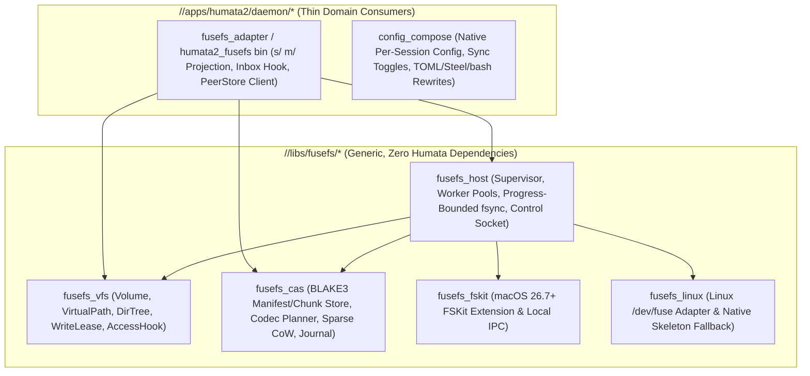

# Humata 2 FUSEFS

**Status:** design, Provisional  
**Owner outcome:** every agent and the owner sees one filesystem-shaped view of
Humata state on every machine, without turning a remote machine into an
NFS-style source of hangs or blocking remote sessions on host sync.

This document is a design for the `FUSEFS` milestone. It does not make the
mount a replacement for the authenticated machine link, a replacement for
terminals, or a distributed build cache. It also does not turn every Humata
domain object into a file: lifecycle, approval, terminal, to-do and delete
semantics remain typed operations. It **does** put file-bearing state --
code, checkouts, session context, non-auth config sync and file moves -- on one
filesystem data plane so that FUSE, MCP, the CLI and session transfer stop
implementing separate copies of the same work.

To keep the implementation surgical, the filesystem and content-addressed chunk
engine live in a **standalone, domain-agnostic crate family (`//libs/fusefs/*`)**
with zero dependencies on Humata domain types, protobufs or services. Humata
consumes only its narrow public Rust traits and types in thin adapter crates
under `apps/humata2/`.

## 0. Intent hierarchy

### Level 0: owner and agent behavior

**The filesystem makes Humata feel like every agent is on one machine.**

The terminal layer already lets the owner treat a remote terminal as a normal
Humata session. FUSEFS completes that illusion for files:

- an agent addresses another session by channel/session and ordinary path;
  it does not need `host:` syntax, SSH, an upload command or a machine-local
  absolute path;
- the owner can browse a channel, desk, session, repository, conversation and
  shared folder in one local tree;
- a file on another machine behaves like a lazily available local file to
  `ls`, `cat`, `less`, `sed`, `grep`, `rg`, editors and `cp`;
- the transport is invisible on the success path: content arrives by
  compressed `BLAKE3`-verified chunks, not as a user-visible "download" that
  must be started and tracked;
- an approved copy or edit uses the same filesystem path the agent already
  named; the approval boundary is visible, the machine transfer machinery is
  not;
- remote sessions are **never blocked or slowed down by syncing with the local
  Mac**: each remote machine uses its own local logins, runs off native local
  paths and its latest cached config snapshot when the Mac is closed or slow,
  and serves host FUSE reads at background priority without locking its own
  worktree;
- the Mac host is canonical for shared non-auth config (such as skills), with
  per-category Settings switches (`skills`, `instructions`, `mcp`, `settings`),
  programmable path/MCP rewrite rules (declarative TOML, embedded `Steel`, or
  `bash`), and an instant **"rage-quit" switch** that reverts any category or
  machine back to its own native config with zero residue;
- remote source and context do not make a remote build cache part of the
  recursive tree. Work happens on its owning machine with native build inputs
  and outputs;
- an offline or pending-approval operation fails quickly in ordinary shell
  terms, with a Humata request/error pointer, instead of looking hung;
- machine placement remains inspectable under `machines/`, but it is
  diagnostic. The owner can spend an ordinary day in `channels/`, `desks/`
  and `s/`.

Examples:

```bash
# The owner is on This Mac. The session may be on gpu-box.
ls   ~/.humata/fuse/main/channels/ml/sessions/fix-auth/work/api
rg   'cache miss' ~/.humata/fuse/main/channels/ml/sessions/fix-auth/context
cat  ~/.humata/fuse/main/s/se_01JAB/work/api/src/main.rs

# Another agent copies one logical file (or directory) into its own checkout.
# No machine name or upload/download command is involved.
cp "$HUMATA_FUSE_ROOT/s/se_01JAB/work/api/design.md" \
   "$HUMATA_FUSE_ROOT/s/se_02JCD/work/api/"
```

The `cp` may create an Inbox approval because it writes another session or a
different machine. Once approved, a turn-bounded (or 10-minute) subtree lease
lets normal multi-step POSIX sequences (temp-file write + `fsync` + `rename`,
or `cp -r`) complete naturally, and may execute as a server-side
chunk-deduplicated copy. Those details are not different user-facing transfer
products.

### Level 1: logical filesystem behavior

- Every session has one stable `s/<session-id>` identity; names are symlinks.
- Code/checkouts, session context, sanitized config views and file-bearing
  state are readable through that path.
- The holder's own checkout and live agent config home remain on native local
  disk where the session runs.
- The global view is a real logical namespace, but remote bytes are fetched
  only as metadata/chunks are needed.
- Reads are free across visible sessions (except credentials, which are never
  exposed in the mount). Writes to the caller's own session are direct;
  other-session/machine writes have one approval, subtree-lease and generation
  rule.
- Rename/unlink of ordinary own files behaves like a filesystem. Moving or
  deleting a session is a domain plan, not `mv` or `rm -rf` on the mount.

### Level 2: what is file state and what stays a domain operation

File-based:

- repositories, worktrees, checkouts and shared files;
- generated conversation/context views and transcripts;
- non-secret agent config views, synced config bundles (skills, instructions,
  settings, scrubbed MCP definitions) and per-session mutable agent state;
- file content carried by a session move, fork, checkout or owner copy;
- transfer manifests, chunk status and diagnostics.

Typed operations remain:

- terminal input/output and terminal lifecycle;
- session start/resume/stop/fork/move/archive/rebuild;
- Inbox ask/explain/approve/wait;
- delete planning/confirmation/trash;
- to-do, board/review and other product state;
- machine enrollment, shutdown, sync settings and version migration.

FUSEFS carries the bytes those operations name. It does not loosen the RPC
boundary by making every state transition a magic write to a file.

### Level 3: implementation model

A standalone, reusable filesystem crate set (`//libs/fusefs/*`) implements the
generic virtual namespace, `BLAKE3` manifest/chunk CAS, adaptive codec planner,
sparse copy-on-write overlays, lease enforcement hooks and OS backends
(`FSKit` on macOS, `/dev/fuse` + degraded skeleton on Linux). Humata embeds that
library inside a small machine-local server (`humata2_fusefs`), supplying the
Humata namespace projection, Inbox access hook and authenticated peer-link
transport. A companion native composer (`humata2_config_compose`) materializes
per-session native agent config directories with local auth pass-through and
configurable non-auth host sync.

### Level 4: backend and platform detail

FSKit, libfuse, process identity, compression, cache, WAL/lock behavior and
crash handoff are backend concerns encapsulated inside `//libs/fusefs/*`. They
may change how the same behavior is implemented, but none may add a second
owner-visible transfer model or leak Humata policy into the generic crates.

## 1. Goals

1. Compose each agent's config home onto **native per-session storage**
   (`<machine-root>/.sessions/<id>/config/<agent>/`): bind to that machine's own
   local auth, merge host-canonical non-auth config (skills, instructions, MCP,
   settings) asynchronously according to Settings toggles and user path/MCP
   rewrite rules (TOML, `Steel`, or `bash`), enforce Humata's protected MCP
   entry, and expose `s/<id>/config/<agent>` in the FUSE tree as a
   secret-scrubbed view.
2. Put all readable Humata state under one tree: machines, channels, desks,
   sessions, repositories, conversation context, terminal output, shared
   files, sanitized session config and Inbox request status.
3. Make remote state lazy. A lookup or small range read fetches only the bytes
   needed; opening a large file does not download the file.
4. Keep remote machine access on the existing authenticated peer link, but
   collapse its file I/O into one `BLAKE3` manifest/chunk protocol used by both
   FUSE callbacks and owner-approved transfers.
5. Use one model for metadata, content-addressed compressed chunks, sparse
   copy-on-write edits, turn/subtree leases and resumable commit. `open/read`,
   `cp`, `upload`, `download`, checkout, session carry, config bundle sync and
   remote materialization share bytes and one journal rather than parallel
   implementations.
6. Give an agent:
   - immediate native writes to its own session's storage and config;
   - reads of every visible session on every machine;
   - a quick, non-blocking request flow before writing another session or
     another machine, followed by a POSIX-friendly subtree lease once approved.
7. Keep normal development tools fast. A session's working trees and config
   homes live on native disk. `git status`, `rg`, SQLite WAL, compilers and
   build tools do not acquire a userspace FUSE hop or network wait merely
   because FUSEFS exists.
8. Never block or starve remote sessions on host sync (`AWAY` parity). A remote
   machine launches sessions, reads same-machine sibling `work/` and `context/`,
   and writes native disk with zero host round-trips when the Mac is closed,
   slow, or actively reading remote files.
9. Keep live terminals, reconnect, resume, reboot recovery, shutdown and
   cross-machine moves unchanged. A filesystem failure or config-sync toggle
   flip must not terminate a holder or ask the holder to move its terminal.
10. Preserve MASSDELETE. A kernel unlink or rename is never a substitute for a
    planned session delete, machine transfer or channel move.
11. Keep domain boundaries. A file is not an authorization boundary or a
    substitute for Inbox approval, a session move, a terminal action or a
    delete plan. The filesystem carries the bytes; typed domain RPCs carry
    intent.
12. Keep the codebase surgical. Build the generic filesystem, CAS/CoW engine
    and OS mount adapters in standalone `//libs/fusefs/*` crates with zero
    Humata dependencies, consumed by Humata exclusively through narrow public
    traits and types.

## 2. Non-goals

- Mounting over or mutating `~/.claude`, `~/.codex`, or `~/.copilot` on any
  machine.
- Syncing credentials, keychain items, login cookies, `.credentials.json`,
  `auth.json`, OAuth records or inline MCP secret values across machines, or
  exposing them anywhere in the FUSE mount.
- Blocking a remote session's launch, turn, or `fsync` on host reachability or
  background config sync.
- Making every remote file writable without approval as if it were own-session
  storage.
- Running a build on a remote virtual directory and expecting local build-cache
  performance.
- Mirroring `node_modules`, compiler outputs, Bazel outputs, virtual
  environments, package caches or other generated caches across machines by
  default.
- Replacing SSH, the peer protocol, holders, the revive/restart journal, or
  Inbox approval. The existing transfer engine is retained as the resumable
  journal and becomes a consumer of the shared file data plane.
- Putting Humata protobufs, session records, Inbox types, or agent-specific
  config parsers inside `//libs/fusefs/*`.
- Exposing every process on the machine as a security principal. FUSEFS
  enforcement is additive to containment; uncontained same-user software can
  still reach ordinary OS-visible paths.

## 3. Stable topology

The mount is:

```text
~/.humata/fuse/<root>/
```

`<root>` is a logical namespace name, not a native directory selected by the
owner. Its default is `main`. The name is stable and is the same in every
machine's local mount. A future second root is another independent view, not a
second copy of a channel.

The tree has exactly one canonical identity for an object. Friendly names are
symlinks to that identity.

```text
~/.humata/fuse/main/
  README.md
  s/
    se_01J...
      info.json
      machine                 -> ../../m/ma_host/s/se_01J...
      work/
        api/                  # session repository view (native symlink locally)
        web/
      context/
        turns/
          0001.md
          0002.md
        transcript.jsonl
        summary.md
      terminal/
        agent.scrollback
        shell-01.scrollback
      config/
        claude/               # secret-scrubbed read view of session config
        codex/
        copilot/
      inbox/
        requests/
      control/
        errors/
  m/
    ma_01J...
      info.json
      s/                     # this machine's sessions, by id
  channels/
    ml/
      info.json
      shared/                -> ../../m/...
      sessions/
        fix-auth             -> ../../../s/se_01J...
        indexer              -> ../../../s/se_02J...
  desks/
    desk/
      sessions/
        plan-q4              -> ../../../s/se_03J...
  machines/
    this-mac                 -> ../m/ma_01J...
    gpu-box                  -> ../m/ma_02J...
  requests/
    rq_01J....json            # status/pointer for a refused write
  control/
    state.json
    topology.generation
    errors/<operation-id>.json
```

### 3.1 Canonical paths and native backing

- `s/<session-id>` is the only session identity. It never includes a channel,
  desk, title or machine.
- `m/<machine-id>` is the only machine identity. `this-mac` and user-visible
  machine names are aliases, following D543 rather than inventing a special
  host object.
- Channel, desk and machine trees are generated from topology metadata. Rename,
  move and reparent are atomic symlink/metadata changes.
- Slugs are display conveniences. If two objects have the same display name,
  the view uses a short stable suffix such as `login--01JAB`.
- Remote symlink targets use virtual relative paths inside the mount. A remote
  symlink never points to an arbitrary absolute path supplied by another
  machine.
- The native backing root on each machine is also stable by session id:
  `<machine-root>/.sessions/<id>/` (with `work/` and `config/<agent>/` beneath
  it). A channel directory contains links to sessions rather than owning their
  physical path. This removes same-machine path churn.
- **Local fast path (`1.00x` native disk):** A session's real `cwd` is its
  native `<machine-root>/.sessions/<id>/work/...` directory, and its live
  config home (`CLAUDE_CONFIG_DIR`, `CODEX_HOME`, `COPILOT_HOME`) is its native
  `<machine-root>/.sessions/<id>/config/<agent>/` directory. Inside the local
  mount, `s/<local-id>/work` resolves via native symlink to that local backing
  directory whenever containment allows it, so local `git status`, `rg` and
  builds pay zero userspace FUSE hops once resolved.
- **Sanitized config view:** `s/<id>/config/<agent>` in the FUSE tree exposes
  the session's composed config directory **with all `Secret`-classified nodes
  omitted/denied**. Because the running agent reads its own native config path
  directly rather than routing through FUSE, the agent uses its own machine's
  local auth seamlessly while cross-session and cross-machine FUSE readers can
  never see credentials.
- **Native skeleton continuity:** When FSKit has not yet been approved in macOS
  System Settings or `/dev/fuse` is absent inside a rootless Linux container,
  the daemon maintains the local `~/.humata/fuse/main/{s,m,channels,desks,machines}`
  symlink skeleton natively for local sessions and marks remote nodes
  `MountUnavailable`, so local `s/<id>` paths work from second zero.
- **Zero-error omitted caches:** Remote `BuildCache` and `Generated` subtrees
  appear as stub directories containing only a synthetic `.humata-omitted.json`
  file (plus `user.humata.omitted_bytes` xattr) so recursive `rg` and `find`
  exit `0` while transferring zero cache bytes.

## 4. Architecture and surgical crate split

### 4.0 Standalone `//libs/fusefs/*` vs. Humata consumers

Following the precedent of `//libs/tca-rust` and `//apps/humata2/terminal/*`,
the filesystem is built as an independent, generic Rust crate family under
`libs/fusefs/` that knows nothing about Humata sessions, channels, Inbox cards,
agent CLIs, or Humata protobufs.



| Package | Crate | Responsibility & Dependency Boundary |
|---|---|---|
| `//libs/fusefs/vfs` | `fusefs_vfs` | Pure semantic VFS traits (`Volume`, `AccessHook`, `CallerContext`), `NodeId`, `VirtualPath` normalization, `..` capability-root clamping, synthetic symlink/stub tree builder, subtree `WriteLease` table, and typed `VfsError`. Zero OS mount or network deps. |
| `//libs/fusefs/cas` | `fusefs_cas` | Generic `BLAKE3` 256-bit chunk & paged manifest store (`DirManifest`, `FileManifest`), adaptive `lz4`/`zstd`/`none` planner, LRU budget eviction, sparse local Copy-on-Write extent overlays, durable commit journal, and abstract `ChunkTransport` / `InvalidationSource` traits. |
| `//libs/fusefs/fskit` | `fusefs_fskit` | macOS 26.7+ FSKit extension bridge (`objc2-fs-kit` + minimal signing entry shim if required by Xcode/codesign) and versioned local Unix IPC to `fusefs_host`, including `MNT_DONTBROWSE` Finder suppression and capability-root routing. |
| `//libs/fusefs/linux` | `fusefs_linux` | Linux `/dev/fuse` adapter (over `fuser`), caller PID extraction from kernel fuse header, and explicit degraded native-symlink skeleton writer when `/dev/fuse` is absent. |
| `//libs/fusefs/host` | `fusefs_host` | Embeddable server runtime binding a `Volume` + `CasEngine` + platform `FilesystemBackend`, bounded priority worker pools, progress-bounded `fsync` coordinator, and control/health socket. |
| `//apps/humata2/daemon/fusefs_adapter` | `humata2_fusefs_adapter`, `humata2_fusefs` bin | Thin Humata consumer of `//libs/fusefs/*`: projects `s/`, `m/`, `channels/`, `desks/`, `machines/` and `.humata-omitted.json` onto `fusefs_vfs`; implements `AccessHook` (creating Inbox requests + protected-root `EPERM`); implements `ChunkTransport` over `humatad2`'s authenticated peer socket with `AWAY` `host_reachable` awareness. |
| `//apps/humata2/daemon/config_compose` | `humata2_config_compose` | Native per-session config composer (`<machine-root>/.sessions/<id>/config/<agent>/`), `[sync]` Settings toggles & rage-quit switch, machine-local auth pass-through, and the declarative TOML / `Steel` / `bash` path & MCP rewrite pipeline. |

Visibility follows `AGENTS.md`: `//libs/fusefs/*` exposes only the narrow public
traits and value types needed by `fusefs_adapter` (and internal subpackages),
and edits to `humatad2`, `.proto` schemas, or UI crates never recompile
`//libs/fusefs/*`.

### 4.1 The `humata2_fusefs` server process

Each machine runs one small Rust process, `humata2_fusefs` (built from
`fusefs_adapter` + `fusefs_host`), supervised by the platform user service. It
is not a child of `humatad2` and is not part of `Migrate the daemon`.

It owns:

- the `fusefs_host` mount runtime and Humata `Volume` projection;
- remote metadata, `BLAKE3` chunk cache and bounded invalidation journals;
- subtree write leases and sparse copy-on-write overlays;
- the local control socket and capability hand-off from `humatad2`;
- bounded request workers for filesystem callbacks.

It does not own:

- terminal holders or terminal I/O;
- live agent config home directories (which are native on disk);
- session lifecycle records;
- the machine-link enrollment key or SSH process;
- channel/session move orchestration;
- delete planning, trash, archive or restore;
- credentials.

`humata2_fusefs` talks to the local daemon over a long-lived authenticated Unix
socket. After a daemon restart, `humata2_fusefs` reconnects using the same
protocol generation; existing local files and cached remote chunks remain
available. An unavailable daemon makes new cross-session mutations fail quickly;
it never stalls the mount or running sessions.

On upgrade, the old `humata2_fusefs` stays serving until a new server has passed
a self-check and taken the control socket. Agents' native `cwd`, native config
directories and open native file descriptors never depend on either daemon's
upgrade. FSKit's extension process and `humata2_fusefs` are separate for the
same reason: the OS-facing module is a narrow IPC adapter while state lives in
the long-lived Rust server.

### 4.2 Crash behavior

There is no guarantee that a dead userspace filesystem preserves arbitrary
in-flight virtual handles. The design narrows the blast radius so live agents
are completely insulated:

1. Working trees and session config homes (`CLAUDE_CONFIG_DIR`, `CODEX_HOME`,
   `COPILOT_HOME`), including all mutable SQLite/WAL and transcript files, live
   100% on native disk—never behind FUSE/FSKit path traversal.
2. Sessions start with native, stable-by-id working and config directories.
3. The mount server never owns the only copy of session data.
4. A callback returns `EIO`, `ESTALE`, `ENETUNREACH` or `EAGAIN` (for `readdir`
   queue saturation only, never `fsync`) within its deadline after a crash. It
   never retries forever.
5. The supervisor restarts `humata2_fusefs` without remounting when the backend
   can reconnect. If remount is required, native agent processes keep running
   untouched; new uncached remote lookups fail quickly during the short gap.
6. `control/errors/<id>.json` records the original typed error, the mount
   generation and the action that fixes it.

### 4.3 Public API shape of `//libs/fusefs/vfs`

`fusefs_vfs` exposes a small, domain-neutral Rust trait surface that Humata
(or any future consumer or in-process test harness) implements:

```rust
pub trait FilesystemBackend: Send + Sync {
    fn mount(&self, cfg: &MountConfig) -> Result<MountHandle, MountError>;
    fn serve(&self, volume: Arc<dyn Volume>, stop: StopToken) -> Result<(), ServeError>;
}

pub trait AccessHook: Send + Sync {
    fn authorize(&self, req: &CallerContext, op: &VfsOp) -> Result<Permit, VfsError>;
}

pub trait Volume: Send + Sync {
    fn lookup(&self, req: &CallerContext, parent: NodeId, name: &FsName) -> Result<Node, VfsError>;
    fn attributes(&self, req: &CallerContext, node: NodeId) -> Result<Attributes, VfsError>;
    fn entries(&self, req: &CallerContext, node: NodeId, cursor: PageCursor)
        -> Result<DirectoryPage, VfsError>;
    fn read_link(&self, req: &CallerContext, node: NodeId) -> Result<LinkTarget, VfsError>;
    fn open(&self, req: &CallerContext, node: NodeId, flags: OpenFlags) -> Result<HandleId, VfsError>;
    fn read_at(&self, req: &CallerContext, handle: HandleId, range: Range<u64>)
        -> Result<Bytes, VfsError>;
    fn write_at(&self, req: &CallerContext, handle: HandleId, offset: u64, bytes: &[u8])
        -> Result<u64, VfsError>;
    fn commit(&self, req: &CallerContext, handle: HandleId, deadline: ProgressDeadline)
        -> Result<(), VfsError>;
    fn create(&self, req: &CallerContext, parent: NodeId, name: &FsName, kind: CreateKind)
        -> Result<(Node, HandleId), VfsError>;
    fn rename(&self, req: &CallerContext, from_dir: NodeId, from: &FsName, to_dir: NodeId, to: &FsName)
        -> Result<(), VfsError>;
    fn unlink(&self, req: &CallerContext, parent: NodeId, name: &FsName, dir: bool)
        -> Result<(), VfsError>;
}
```

## 5. One file data plane (`//libs/fusefs/cas`)

The core is a production file replication and access protocol, not a file
browser layered beside the current upload/download implementation.

### 5.1 Manifest/chunk representation and `BLAKE3`

Every file-bearing object has a versioned manifest:

```text
DirectoryManifest {
  inode, generation, entries[], next_page, small_entry_digests
}

FileManifest {
  inode, generation, size, permissions, mtime, class,
  chunks: [{ index, logical_len, blake3, encoded_len, codec }]
}

SessionSnapshot {
  session_id, source_machine, target_generation,
  clones: [CloneRecipe],              # preserves D313 carry_cheap Git bundle + main-clone checkout
  dirty_work_manifests,               # untracked/modified worktree files + bundle payloads
  context_manifests,
  config_upper_manifests,             # non-secret session upper state only
  record_export, omitted_build_caches, blake3_checksum
}
```

- **Chunk unit:** The default cache/digest unit is a **256 KiB logical chunk**
  (four chunks = at most **1 MiB** per interactive wire batch, matching
  `humata2_chunk::CHUNK_MAX`). Because `FileManifest.chunks` records
  `logical_len` per chunk (indexed via an in-memory prefix-sum offset table in
  $O(\log N)$), `T1` also benchmarks **FastCDC** (`min = 64 KiB`,
  `avg = 256 KiB`, `max = 1 MiB`) for snapshot/append workloads so small
  mid-file insertions do not shift all subsequent chunk boundaries.
- **Digest (`BLAKE3`):** Each chunk is identified and verified by its decoded
  256-bit **`BLAKE3`** digest before any byte is exposed to a caller. `BLAKE3`
  runs at 3–8 GB/s across ARM NEON and x86 SIMD (eliminating SHA-256 bottlenecks
  on Linux VMs without SHA-NI) and its internal Merkle tree supports verified
  4 KiB sub-range page-ins for `mmap`.
- **Machine-wide sharded store:** Decoded/framed chunks live in one machine-wide
  store (`<machine-root>/.humata/cache/chunks/<b0>/<b1>/<blake3>`), retiring the
  per-channel 1 MiB SHA-256 `<channel>/.carry/have` directory in
  `daemon/sessions_carry/src/carry_chunks.rs` so chunks deduplicate across all
  channels, forks, config bundles and sessions on a machine.
- **Inline small files:** Metadata for files $\le 64\text{ KiB}$ may carry the
  encoded bytes inline (`info.json`, context turns, settings, small sources) in
  one round trip without a follow-up `ReadChunks`.

The sender chooses the codec (`lz4`, `zstd`, or `none`, reusing/aligning with
`humata2_chunk`) once per chunk using negotiated peer capability plus a cheap
planner:

1. **File and content:** inline or skip sub-1 KiB and already-compressed
   classes; sniff unknown content before paying for a stronger codec.
2. **CPU headroom (source-first isolation):** elevated source CPU load (such as
   a running build or agent turn on a remote box) immediately selects `lz4` or
   `none`; only idle source CPU permits `zstd`.
3. **Bandwidth pressure:** a slow or contended link with useful measured ratio
   favors `zstd` for background materialization; interactive FUSE reads default
   to `lz4`.
4. **Learned ratio:** two weak-saving chunks switch subsequent chunks in that
   stream to `none` or `lz4`.
5. **Deadline:** interactive FUSE reads never block on expensive compression.

### 5.2 One protocol for every file consumer

`fusefs_cas::ChunkTransport` defines one narrow peer data API:

```text
ListPage(root, cursor, generation)
StatMany(nodes)
GetManifest(file, generation)
HaveChunks(blake3_digests[])
ReadChunks(chunk_requests, accept_codecs)
PutChunks(encoded_chunks)
Commit(expected_generations[], changed_manifests[], journal_id)
MutateMetadata(expected_generation, rename_or_unlink_op)
```

The existing transfer engine remains the durable scheduler and bounded queue,
delegating byte production and verification to `fusefs_cas`. `humata2_fusefs`,
owner upload/download, session carry, config-bundle sync, checkout placement and
remote copy share one chunk store and format:

- **FUSE `read`:** fetches missing chunk digests via `GetManifest` +
  `ReadChunks`.
- **Materialization & `ConfigBundle` sync:** journals missing chunk digests in
  the background and materializes native trees atomically once verified.
- **Approved remote edit / `cp`:** uploads only dirty/missing chunks into the
  destination's chunk store via `PutChunks` (completely outside the target
  worktree), then applies one atomic `Commit`.
- **Cross-machine `MoveSession` (`D313` preserved):** generates a
  `SessionSnapshot` keeping `carry_cheap.rs`'s Git `Clones` recipe (destination
  clones from its local main clone + applies `clones/<name>.bundle` and
  `humata.bundle` for `refs/humata/*`, skipping `.git` packfiles and unchanged
  tracked files) while negotiating `HaveChunks` and transferring bundle files +
  dirty/untracked worktree files + non-secret config upper over `ReadChunks`.

The domain RPC remains the verb (`MoveSession`, `StartSession`,
`PlanDeleteSessions`, `Approve`, `Fork`, `Materialize`).

**Host-relayed remote-to-remote routing:** Humata uses a star peer-link topology
where enrolled remote machines connect to the host rather than maintaining an
$N \times N$ peer mesh. Cross-machine `ChunkTransport` calls between two remote
machines (`Remote A → Remote B`) therefore route through the host by default:

- **Cache-assisted & zero-reencode relay:** If the host's local `BLAKE3` CAS
  already holds a requested chunk, it serves `Remote A` directly without waking
  `Remote B`. Otherwise, it forwards the compressed chunk frame verbatim when
  codecs match (`lz4`/`zstd`/`none`), avoiding decompress/recompress overhead on
  the host.
- **Bounded relay budget:** The host caps in-flight relayed streams and memory
  (e.g., 16 MiB relay window) so bulk copies between two fast remote machines
  cannot starve or OOM a laptop host.
- **Transport-opaque:** Because `//libs/fusefs/cas` only depends on the abstract
  `ChunkTransport` trait, an optional direct remote-to-remote fast path (e.g.,
  same-LAN or Tailscale) can be added later inside `humata2_fusefs_adapter`
  without changing `//libs/fusefs/*`.

### 5.3 File classes and zero-error `BuildCache` stubs

Every file or subtree has a class:

| Class | Behavior |
|---|---|
| `Source` | Manifested and fetched on demand. |
| `Context` | Generated locally from the owning machine's transcripts; inline for small turns. |
| `Metadata` | Small host/machine/session records, pushed eagerly when connected. |
| `SessionState` | Agent config/state; live session config homes stay native locally; FUSE view scrubs `Secret`. |
| `VcsInternal` | Manifested for random FUSE reads; replaced by Git `CloneRecipe` bundles during `MoveSession`/checkout. |
| `Generated` | Omitted stub directory in remote views; excluded from default snapshots. |
| `BuildCache` | Omitted stub directory in remote views; never fetched unless explicitly materialized by the owner. |
| `Secret` | Never manifested, synced across machines, copied into snapshots, or exposed in FUSE. |

**Zero-error stub rule for `BuildCache` and `Generated`:** On remote views, an
omitted directory (such as `target/` or `node_modules/`) returns `S_IFDIR | 0555`
with `user.humata.class` and `user.humata.omitted_bytes` xattrs, and `readdir`
succeeds (`0`) yielding **only** a single synthetic `.humata-omitted.json` file
recording the omitted byte count and `humata2 fs materialize <path>` command.
Recursive `rg`, `find`, and `grep -r` finish cleanly with exit code `0` and
zero network cache reads instead of aborting on `EACCES`/`EIO`.

### 5.4 Leases, push invalidation, and zero-host-block remote autonomy

Remote sessions must never stall on syncing with the local Mac (`AWAY` parity):

- **Link-state-aware revalidation (`0 ms` when away):** `humata2_fusefs` tracks
  `host_reachable` (`PeerUplink` live state). While connected, directory/manifest
  leases last 30 seconds and extend via push invalidation. When
  `host_reachable == false`, **revalidation waits `0 ms`** (skipping the 250 ms
  RPC timer): a remote machine serves its own sessions and same-machine sibling
  sessions live, serves `channels/` and `desks/` from its last persisted
  topology snapshot (marked stale in xattr/`control/`), and fails uncached
  *other-machine* reads (both host and host-relayed remote-to-remote) in
  `< 1 ms` with `MachineOffline`.
- **Fire-and-forget outbound invalidation:** Local writes bump an in-memory
  generation counter and append to a bounded coalescing ring buffer. Link
  backpressure or disconnect coalesces into a single session watermark—a remote
  session's `write`, `rename`, or `fsync` never waits on the Mac.
- **Lock-free, background-QoS source reads:** Serving `GetManifest` or
  `ReadChunks` to another machine opens backing files `O_RDONLY` without locks
  (returning `ESTALE` to the *remote reader* if a local writer mutates/renames
  the file mid-read; local writers never wait) and runs on a bounded worker pool
  at lowered CPU/IO priority (`nice` / utility QoS).
- **Reconnect:** Each side exchanges highest generations and its bounded
  invalidation journal; an overflowed journal refreshes one generation snapshot
  for the affected session without a recursive byte scan.

### 5.5 Syscall-to-wire plan

This table is the optimization contract. A callback may do less than the
maximum, never more.

| Filesystem operation | Local | Remote without a cached node | Reuse/cache behavior |
|---|---|---|---|
| `lookup` / `stat` | Native symlink or generated metadata | `StatMany` batched on first miss (`< 1 ms` `MachineOffline` if link down) | Generation lease, 30 s (`0 ms` stale-serve if away) |
| `readdir` | Native iterator / generated list | Paged `DirectoryManifest`; 256 names or 64 KiB max per page | Whole page cached; stub `.humata-omitted.json` for caches |
| `open` read | Acquire handle, read no bytes | Acquire generation-bound handle from manifest; fetch no content | Open never downloads the file |
| `read` / `mmap` read | Native read | Map range to 256 KiB chunk `BLAKE3` ids; coalesce $\le 4$ (1 MiB) per `ReadChunks` | Sequential 1-chunk read-ahead after two adjacent misses; cache by `BLAKE3` |
| `create` / `mkdir` / `symlink` | Native metadata op | Under active subtree lease, stage locally and commit metadata in `Commit` | Refresh destination manifest atomically |
| `write` / `truncate` | Native | Under active subtree lease, write local sparse CoW extent; fetch base chunk only on partial-chunk read | Base chunks shared by digest, never copied whole |
| `fsync` remote | Native `fsync` | Upload dirty chunks via `PutChunks` + atomic `Commit` with **1,000 ms stall/progress bound** (returns `0` on completion, `ENETUNREACH`/`EIO` on link drop—never `EAGAIN`) | Resumable in journal on link loss; POSIX callers never see false `EAGAIN` |
| `close` / release | Flush native state | Queues dirty CoW chunks if not yet `fsync`ed | Journal survives server/link restart |
| `rename` ordinary file | Native atomic rename | Under subtree lease, server-side `MutateMetadata` (or atomic temp-to-target commit if `.tmp` has dirty CoW chunks); no unchanged target bytes downloaded | Updates inode generation once |
| `unlink` ordinary file | Native unlink/trash | Under subtree lease, server-side trash/metadata commit; no data download | Protected roots still `EPERM` |
| `copy_file_range` / copy | Native reflink/copy | Deduplicate manifests (`HaveChunks`) and transfer only missing `BLAKE3` chunks | Server-side when source and destination share one machine |

### 5.6 Cache budget and eviction

The cache is machine-local (`<machine-root>/.humata/cache/`) and is not session
state:

- Default budget: 10 GiB or 5% of free native storage, whichever is smaller.
- Retained priority (high to low): dirty CoW commit journals (never evicted) >
  active `ConfigBundle` chunks > session `Context` & `Source` chunks >
  `Generated` & owner-materialized `BuildCache` chunks.
- Evicts whole immutable chunks in LRU order within each tier.
- Cache growth never blocks native worktree writes. At 90% budget, bulk
  materialization requires confirmation while single-chunk interactive reads
  replace older LRU chunks.

## 6. Filesystem operation semantics

`allow`, `deny`, and "starts an approval" are explicit decisions.

| Operation | Own session, local machine | Another session, same machine | Another machine |
|---|---|---|---|
| `lookup`, `getattr`, `readdir` | Native symlink or generated view | Readable metadata | Cached or bounded peer metadata (250 ms; `< 1 ms` if offline) |
| `open(O_RDONLY)`, `read`, `mmap` read | Native or local cache (`Secret` denied in FUSE) | Allowed (`Secret` denied) | Cached range or bounded peer read (`Secret` denied) |
| `open(O_WRONLY/O_RDWR)`, `create`, `truncate`, `write` | Allowed natively | `EACCES` + Inbox request unless covered by active subtree lease or own-machine `shared/` policy | `EACCES` + Inbox request unless covered by active subtree lease |
| `rename`, same subtree | Allowed for ordinary session data | Covered by subtree lease after Inbox approval | Covered by subtree lease; server-side metadata/chunk commit |
| `rename`, session/channel/machine root | `EPERM` / `EXDEV` | `EPERM` / `EXDEV` | `EPERM` / `EXDEV` |
| `unlink`, `rmdir`, ordinary child | Allowed in own work/config | Protected-root check first; then subtree lease / Inbox request | Protected-root check first; then server-side trash/commit |
| `unlink`/`rmdir` session, repo root, config root, channel, desk, machine, or friendly alias | `EPERM`; names lifecycle/delete RPC | `EPERM` | `EPERM` |
| `fsync` local/remote | Native sync | Native sync on leased target | Uploads dirty chunks + atomic `Commit`; returns `0` while making progress, `EIO`/`ENETUNREACH` if stalled $> 1,000\text{ ms}$ |
| `setxattr`, owner/control | Denied from untrusted callers | Denied | Denied |

### 6.1 Read-only generated views and local `context/` authority

- **Owning-machine authority for `context/`:** Each machine generates synthetic
  `context/` files (`turns/*.md`, `transcript.jsonl`, `summary.md`) directly
  from its own local session transcripts. Two sessions on `gpu-box` reading each
  other's `context/` never round-trip through the Mac's mirror. The host mirror
  is consulted only as a fallback when reading a remote session whose machine is
  currently offline.
- `context/` and `terminal/*.scrollback` are read-only. Typing remains a
  terminal RPC verb.

### 6.2 Renames and symlinks

- A rename inside an own-session worktree is native and touches no topology.
- A rename crossing a repository, session, channel, desk, machine or backing
  root returns `EXDEV` and names the domain RPC.
- A same-machine channel/desk/session rename updates friendly symlinks and
  metadata with zero holder restarts and zero path rewrites (`LIVEHOLDER`).
- A cross-machine session move remains `MoveSession` (freeze, build
  `SessionSnapshot` with Git `CloneRecipe` + missing `BLAKE3` chunks, verify,
  resume, trash source). Shell `mv` cannot move a session.

### 6.3 Unlink and MASSDELETE

Neither an agent nor the owner shell can `rm -rf` a session out of `s/`, a
channel out of `channels/`, a repo root out of `work/`, or an alias out of a
friendly tree (`EPERM`). Destructive session/topology deletion always goes
through `PlanDeleteSessions` + `DeleteSessions` (`MASSDELETE`).

## 7. Approved cross-session and remote writes

While an Inbox request is pending, FUSEFS **returns `EACCES` immediately (< 50 ms)
with a request pointer**. It never blocks a syscall on human approval.

### 7.1 Request flow, subtree leases, and POSIX atomic-write compatibility

Standard POSIX tools (`sed -i`, `vim`, Python/Rust file writers, macOS
`copyfile(3)`, agent `Edit` harnesses, `cp -r`) do not mutate a target in one
syscall: they create randomly named sibling temp files (`foo.rs.tmp.8391`),
write, `fsync`, `chmod`, and `rename(.tmp -> foo.rs)`, or create directories and
write multiple files sequentially. A one-use single-path lease would break
atomic temp-file renames and create $N$ sequential Inbox cards for an $N$-file
copy.

FUSEFS therefore scopes approved leases to the **target directory subtree for
the caller's current turn (up to 10 minutes)**:

1. A mutating syscall (`open(O_WRONLY/O_CREAT)`, `create`, `mkdir`, `truncate`,
   `rename`, `unlink`) reaches a non-protected path under another session or
   machine without an active lease.
2. `humata2_fusefs` resolves the logical target parent directory `<dst_dir>`
   (clamped within `<dst_session>/work/<repo>/...`) and atomically creates or
   deduplicates one Inbox request keyed by
   `(caller_session, dst_session, dst_dir, op_class)`.
3. It writes `requests/<id>.json` (reason, caller, `<dst_dir>`, initial target
   path, target generation) and sets `user.humata.request=<id>` where xattrs are
   supported.
4. The syscall returns `EACCES` immediately.
5. The agent calls `inbox_wait <id>` (never filesystem polling) and retries once
   approved.
6. **Subtree/turn lease:** Approval installs a `WriteLease` in `fusefs_vfs`
   keyed to `(caller_session, dst_session, dst_dir)`, expiring at
   `min(now + 10 minutes, caller_turn_end_or_stop_hook)`. Within `<dst_dir>`,
   the caller may create temp siblings, write, `chmod`/`utimens`, `fsync`,
   `rename` temp files over targets, and copy subtrees under that single
   approval.
7. **Per-file generation safety (`ESTALE`):** Every pre-existing target file
   records the `expected_generation` observed when the lease began (or when
   first opened under the lease). If the destination session concurrently
   modified that file (`actual_gen != expected_gen`), `open` or `Commit` fails
   closed with `ESTALE`—approval never silently clobbers newer remote work.

For approved remote file writes:

1. `fusefs_cas` opens a sparse local copy-on-write overlay backed by the base
   `FileManifest` without downloading the whole file.
2. Writes land in local dirty extents; untouched range reads fetch only the
   needed 256 KiB chunk.
3. `fsync` encodes dirty chunks, stages missing `BLAKE3` digests into the
   destination's chunk cache via `PutChunks` (outside the target worktree), and
   commits the new manifest via atomic temp-materialization + `rename` on the
   destination.
4. **Progress-bounded `fsync` (no `EAGAIN`):** Because POSIX tools treat
   `fsync() -> EAGAIN` as fatal write failure and delete their output, `fsync`
   uses a **1,000 ms progress/stall deadline**: as long as chunk batches
   acknowledge forward byte progress at least every 1,000 ms, `fsync` waits
   until `Commit` completes and returns `0`. Only if the link is down or stalls
   with zero progress for $> 1,000\text{ ms}$ does `fsync` return `ENETUNREACH`
   / `EIO`, preserving dirty extents in the local journal for recovery.

### 7.2 Same-machine cross-session writes and `AWAY` mode

Writing another session on the same machine requires the same Inbox approval
(except existing same-machine channel `shared/` writes), preserving audit and
unpushed-work visibility. Once leased, same-machine operations execute via fast
local copy/reflink/rename without network hops.

When a remote machine is in `AWAY` mode (`host_reachable == false`), a
same-machine cross-session `EACCES` request is written into that machine's local
away Inbox journal (`D225`), allowing the owner to approve it over SSH
(`humata login` + `humata inbox`) while the Mac lid is closed and replaying the
record when the host reconnects.

## 8. Agent config composition, machine-local auth, and programmable sync

### 8.1 Native per-session config homes vs. sanitized FUSE view

Live agents receive **native local filesystem paths**—not FUSE mount paths—for
their config homes:

```text
CLAUDE_CONFIG_DIR=<machine-root>/.sessions/<session-id>/config/claude
CODEX_HOME=<machine-root>/.sessions/<session-id>/config/codex
COPILOT_HOME=<machine-root>/.sessions/<session-id>/config/copilot
```

Humata never mounts over, renames, or mutates `~/.claude`, `~/.codex`, or
`~/.copilot` on any machine. Meanwhile, `~/.humata/fuse/main/s/<session-id>/config/<agent>`
exposes a **secret-scrubbed FUSE view** of that native directory so the owner
and other sessions across machines can browse non-secret config, skills, and MCP
wiring in the unified tree.

Why native config homes are mandatory:

1. **Machine-local auth works everywhere:** On headless Linux boxes (and
   file-backed Codex auth on macOS), machine logins live in files such as
   `~/.claude/.credentials.json`, `~/.codex/auth.json`, and
   `~/.copilot/config.json`. Because the running CLI reads its native
   `<machine-root>/.sessions/<id>/config/<agent>` directly, `humata2_config_compose`
   wires **that machine's own auth** locally (via `CLAUDE_SECURESTORAGE_CONFIG_DIR=""`
   for verified macOS Keychain versions, or native local symlinks to that
   machine's real `~/.codex/auth.json` / `~/.claude/.credentials.json` so OAuth
   token refreshes update the machine's real auth in place), while FUSEFS and
   `SessionSnapshot` strictly hide all `Secret` files (`CredentialOutsideMount`)
   from cross-session and cross-machine readers!
2. **Zero FUSE crash or WAL risk:** Every transcript append, `.claude.json`
   atomic temp-file rename, and SQLite WAL lock (`state_5.sqlite-wal`,
   `thread_history_1.sqlite-wal`, `session-store.db-wal`) hits native APFS/ext4
   directly—even if `humata2_fusefs` restarts or `/dev/fuse` is absent in a
   container.

### 8.2 Host-canonical configurable sync and the "rage-quit" switch

The Mac (`host`) is the canonical source for shared non-auth config, exported
asynchronously ("when we can") as a versioned `ConfigBundle` over `fusefs_cas`
into `<machine-root>/.humata/synced-config/<gen>/`. Remote sessions **never**
wait on sync at launch: they always compose against the latest verified local
`<gen>` in `< 1 ms`.

Sync is user-configurable in **Settings › Agents** and persisted in portable
`<humata-home>/config/config-sync.toml` (superseding `skills-settings.json`):

```toml
[sync]
enabled = true               # Master switch: false = instant rage-quit across all categories
skills = true                # Default ON  (host canonical for skills/, commands/, agents/, plugins/)
instructions = true          # Default ON  (host canonical for global CLAUDE.md / AGENTS.md)
mcp = false                  # Default OFF (opt-in; remote boxes keep local MCP servers until enabled)
settings = false             # Default OFF (opt-in; non-secret model/editor preferences)
skills_mode = "host-wins"    # "host-wins" (union local skills, host wins collisions) | "host-only"

[sync.machines."gpu-box"]
# Optional per-machine override (e.g., disable or enable specific facets on one machine)
enabled = true
mcp = true
```

**Layer resolution & instant non-destructive rage-quit:**

- For each category `F` in `{skills, instructions, mcp, settings}` on machine
  `M`:
  - When `sync.enabled && machine_enabled(M) && facet_enabled(M, F)` is **true**:
    `humata2_config_compose` sources `F` from the cached canonical **Host Synced
    Layer** (after running `M`'s rewrite pipeline in `§8.3`), followed by the
    **Humata Protected Layer** (that machine's local `humata` MCP entry) and the
    **Session Upper Layer**.
  - When **false** (default for `mcp`/`settings`, or when the user flips a
    category or master `enabled = false` to **"rage-quit"**): `humata2_config_compose`
    ignores the host bundle for `F` and links/merges directly from **`M`'s own
    native `~/.<agent>/<F>`**, plus the **Humata Protected Layer** and **Session
    Upper Layer**.
- Because real `~/.<agent>` directories are never overwritten, flipping sync OFF
  (in Settings on the Mac, or locally via `humata config sync off --local` over
  SSH while away) atomically re-points native symlinks and re-renders merged
  config files in place—**zero holder restarts (`LIVEHOLDER`), zero leftover
  files, and instant re-enable later from cached chunks**.

### 8.3 Programmable path & MCP rewrite pipeline (TOML, `Steel`, and `bash`)

When syncing config (especially `mcp` or paths inside `settings` / `instructions`)
across macOS and heterogeneous Linux machines, users can customize how paths and
MCP entries are rewritten through a three-stage pipeline defined in
`<humata-home>/config/config-sync.toml` and `<humata-home>/scripts/`:

#### Stage 1: Declarative TOML rules (`config/config-sync.toml`)

```toml
# Prefix rewrites applied to MCP command/args/cwd and path-valued settings
[[path_rewrite]]
machines = ["gpu-*", "linux-*"]
from_prefix = "/opt/homebrew/bin/"
to_prefix = "/usr/local/bin/"

[[path_rewrite]]
machines = ["gpu-box"]
from_prefix = "/Users/avestabarzegar/"
to_prefix = "/home/ubuntu/"

# Per-server MCP overrides (disable OS-specific servers, override command, bind local env)
[mcp.servers."apple-notes"]
machines = ["gpu-*"]
enabled = false

[mcp.servers."github"]
command = "npx"                              # Resolved via target machine PATH
pass_env = ["GITHUB_PERSONAL_ACCESS_TOKEN"]  # Reads value from target machine's own env; secret never synced
```

#### Stage 2: Embedded `Steel` Scheme AST transform (`steel-core`)

For programmatic logic without shell-process overhead or side effects, a rule
may specify an embedded `Steel` script (`steel = "rewrite-mcp.scm"` under
`<humata-home>/scripts/`):

- Runs in-process inside a capability-free `steel-core` VM (no filesystem,
  network, or subprocess primitives; bounded instruction fuel and memory).
- Receives an immutable context map `(ctx)` containing `machine-id`,
  `machine-name`, `os` (`"macos"` / `"linux"`), `arch`, `home-dir`, `agent`
  (`"claude"` / `"codex"` / `"copilot"`), and the parsed, secret-scrubbed
  `config` AST, returning the transformed `config` AST.

```scheme
;; ~/.humata2/scripts/rewrite-mcp.scm
(define (transform ctx)
  (let ((os (hash-get ctx 'os))
        (cfg (hash-get ctx 'config)))
    (if (equal? os "linux")
        (drop-missing-macos-servers (rewrite-homebrew-paths cfg))
        cfg)))
```

#### Stage 3: Target-machine `bash` filter (`~/.humata2/scripts/<name>.sh`)

When rewrites need to inspect the target machine's live tools (`command -v uvx`,
`jq`, custom wrappers), a rule may specify `bash = "rewrite-config.sh"`:

- Follows `MACHINESCRIPTS` (`D680`, `D688`) safety invariants: scripts live only
  in `<humata-home>/scripts/` (named without `/` or `..`; never writable by
  agents, MCP, or RPCs).
- Executes **locally on the target machine** when materializing a new
  `ConfigBundle` generation (5-second timeout; JSON AST on `stdin` with
  `HUMATA_MACHINE`, `HUMATA_OS`, `HUMATA_AGENT`; transformed JSON on `stdout`).

#### Mandatory post-pipeline safety gates

Regardless of which stages run:

1. **Inline secret scrubbing on host export:** Before any host MCP/settings
   bundle leaves the Mac, inline secret literals (`*_TOKEN`, `*_KEY`, `*_SECRET`,
   `Authorization` headers, credential paths) are stripped so `ConfigBundle`
   never carries secrets across the wire.
2. **Schema & protected-MCP enforcement after transform:** `humata2_config_compose`
   validates the resulting JSON/TOML against the agent's schema, **re-inserts
   the target machine's protected `humata` MCP entry** if a transform altered or
   dropped it, soft-omits (with a diagnostic warning) any 3rd-party stdio MCP
   server whose binary is absent on that machine rather than refusing session
   launch, and on script error records `ConfigTransformFailed` (surfacing on the
   Machine page / Inbox like `D686` while keeping the previous valid generation).

### 8.4 SQLite and WAL

Because agent config homes (`CLAUDE_CONFIG_DIR`, `CODEX_HOME`, `COPILOT_HOME`)
and session worktrees live on native local storage, all agent SQLite databases
(`state_5.sqlite`, `thread_history_1.sqlite`, `session-store.db`) and their
`-wal`/`-shm` files always use native OS file descriptors and native kernel
locks. They never depend on FSKit or libfuse lock callbacks.

The `T1` two-process WAL + `SIGKILL` matrix remains a mandatory gate before any
future milestone ever allows mutable SQLite databases to live directly on a
mounted virtual path.

## 9. Access mapping

| Today's concept | FUSEFS form |
|---|---|
| Agent/session token principal | Humata binds a holder/launcher process group (Linux PID) or hidden capability root (`$HUMATA_FUSE_ROOT` on macOS) to a session. |
| Owner/app principal | Short-lived capability handed over the local control socket; never a file in the tree. |
| `FilesReadOtherSession` | Removed as an agent ask. Non-secret session views are readable across the unified tree. |
| `FilesReadOtherMachine` read | Removed as an agent ask. Remote reads use lazy `BLAKE3` chunk reads. |
| `FilesFetchLocal` / `FilesCopyIn` | Replaced by destination write rule + turn/10m subtree `WriteLease`; `file_fetch` is removed. |
| `SharedWrite` own machine | Keeps the existing D755/D777 rule. |
| Other-session local write | `Ask` decision granting a turn/10m subtree `WriteLease` bound to `(caller, dst_session, dst_dir, expected_gen)` (journaled locally when `AWAY`). |
| Other-machine write | `Ask` decision granting a turn/10m subtree `WriteLease` over sparse CoW + `PutChunks`/`Commit`. |
| Session delete/destroy | Never a mount operation; existing access + `MASSDELETE` plan remain (`EPERM` on mount). |
| Session stop/restart/move | MCP/CLI/RPC verbs remain. |

### 9.1 Caller identity and capability-path consistency

- **Linux (`/dev/fuse`):** Kernel supplies calling PID; `fusefs_linux` resolves
  it against registered holder process groups and binds `CallerContext` to the
  session.
- **macOS (`FSKit`):** Public request context provides `uid`/`gid` without a
  portable per-request PID (verified in `T1` including XPC `audit_token_t`). The
  public `~/.humata/fuse/main/` tree is therefore strictly read-only for
  same-user callers (`CallerIdentityUnavailable` on mutation). Each launched
  agent receives `$HUMATA_FUSE_ROOT` pointing to a private capability root
  (`~/.humata/fuse/cap_<cap-id>/`, hidden from other contained sessions via
  `0700` parent permissions and `sandbox-exec` rules in `daemon/contain`)
  exposing the identical `s/`, `m/`, `channels/`, `desks/`, and `machines/`
  hierarchy.
- **Path & symlink invariants:**
  1. `fusefs_vfs` clamps `..` at the capability root so relative symlinks
     (`../../../s/se_01J`) resolve strictly inside `cap_<cap-id>/` and never
     escape into the public read-only `main/` root.
  2. Every session-scoped MCP tool (`sessions_search`, `topology_get`,
     `session_info`) formats returned mount paths with the caller's
     `$HUMATA_FUSE_ROOT` prefix so agents copying or editing returned paths on
     macOS hit their session capability view (filing an Inbox request) rather
     than failing `CallerIdentityUnavailable` on the public path.
  3. Diagnostics and UI cards normalize `cap_<cap-id>` back to logical paths,
     and if `CallerIdentityUnavailable` occurs on `main/`, the error message
     explicitly instructs using `$HUMATA_FUSE_ROOT`.

## 10. MCP and CLI boundary

FUSEFS removes byte-oriented MCP file tools for mounted sessions:

- remove `files_list`, `file_read`, `files_find`, `file_write`, `folder_create`,
  `file_fetch`, and `session_read`.

Keep `sessions_search` as the broad server-side index query across all machines,
returning `$HUMATA_FUSE_ROOT`-prefixed paths for lazy `cat`/range reads.

Keep as typed RPC/MCP/CLI verbs:

- Inbox `ask`, `explain`, `wait`, approve/result;
- to-do and board/review operations;
- session start, resume, stop, move, fork, archive and rebuild;
- `PlanDeleteSessions` / `DeleteSessions` (`MASSDELETE`);
- terminal attach/type/shutdown;
- machine add/stop/reconnect/upgrade and `humata config sync` controls;
- `humata2 fs status` and `humata2 fs materialize` for owner diagnostics and
  explicit cache materialization.

On a machine whose virtual mount cannot start, local sessions still run normally
on native paths and local symlink skeletons, while degraded MCP exposes only
read-only remote file inspection tagged `MountUnavailable`.

## 11. Timeouts, offline behavior and push invalidation

No peer operation is awaited in an unbounded FUSE callback, and offline links
short-circuit in `< 1 ms`:

| Callback | Connected peer budget | When `host_reachable == false` / peer offline | Fallback |
|---|---:|---:|---|
| `getattr`, `lookup` | 250 ms | `< 1 ms` (no timer wait) | Cached metadata (marked stale) or `ENETUNREACH` |
| `readdir` | 250 ms / page | `< 1 ms` | Cached page or `ENETUNREACH`; `EAGAIN` only on local worker saturation |
| `open` read | 250 ms (manifest) | `< 1 ms` | Resident cached manifest or `ENETUNREACH` |
| `read` uncached range | 1,000 ms | `< 1 ms` | Resident `BLAKE3` chunks only; else `ENETUNREACH` |
| Approved local write | Native, 0 ms network | Native, 0 ms network | Normal native filesystem result |
| Approved remote `fsync` | **1,000 ms stall/no-progress bound** (streams to `0` while chunks ack progress) | `< 1 ms` `ENETUNREACH` | Dirty CoW extents preserved in resumable journal; **never returns `EAGAIN`** |
| Background sync / transfer | 30 s per batch | Paused cleanly | Resumable journal; zero impact on foreground callbacks |

Push invalidation tests verify three distinct layers separately: kernel vnode
cache invalidation, local watcher delivery (`FSEvents`/`inotify`), and peer
generation push (with bounded journal or single-snapshot resync on reconnect,
never polling).

## 12. macOS platform (`//libs/fusefs/fskit`)

The production target is macOS 26.7+ via `//libs/fusefs/fskit`:

```text
FSKit framework callback (fskitd)
        |
        v
small signed filesystem extension (objc2-fs-kit + minimal entry shim if required)
        |
        v
local versioned IPC
        |
        v
humata2_fusefs (fusefs_host + fusefs_vfs + fusefs_cas + humata2_fusefs_adapter)
```

- Mounts with `MNT_DONTBROWSE` (`nobrowse`) so Finder sidebars and Desktop do
  not show spurious ejectable drives; `T1` verifies direct mounting at
  `~/.humata/fuse/main` vs hidden `/Volumes` backing + symlink.
- `fuse-t` is used only as a `T1` throwaway benchmark baseline; kext FUSE is not
  shipped.

## 13. Linux worker boxes and container fallback (`//libs/fusefs/linux`)

While the Linux *desktop UI and primary host* milestones (`LINUX`, `ANYHOST`)
are cut (`D485`—desktop/host scope is macOS), **remote worker machines ("boxes")
enrolled over SSH routinely run headless Linux**, including rootless Docker,
Kubernetes, and cloud GPU containers.

`//libs/fusefs/linux` therefore targets headless Linux boxes:

- When `/dev/fuse` is usable, mounts via `fuser` with kernel PID caller binding.
- When `/dev/fuse` is absent or denied (common in unprivileged containers), uses
  no privileged module loading; instead writes the marked **native local
  skeleton** (`~/.humata/fuse/main/{s,m,channels,desks,machines}` pointing to
  local `.sessions/<id>/`) while native session `cwd` and `humata2_config_compose`
  continue operating at 100% capability, and remote `open` returns explicit
  `MountUnavailable`.

## 14. Performance targets

At the FUSEFS spike repository scale:

| Benchmark | Target |
|---|---|
| Warm native `git status` | Baseline (`cwd` and local `work/` symlink stay native) |
| `git status` through mounted own path (if tested without native symlink) | p95 <= 1.10x native and <= 50 ms additional |
| `rg` over a 50k-file own worktree | <= 1.15x native and <= 100 ms additional (1.00x via native symlink) |
| Bazel compile-only input scan/build action | <= 1.10x native, 0 remote bytes |
| Remote session launch & `git status`/`rg` while `PeerUplink` severed or streaming 1 GiB to host | **0 host round-trips** and <= 1.05x idle-box latency |
| Local `getattr`/`readdir` mounted hot path | p95 <= 2 ms / page |
| Cached remote `read` range | p95 <= 20 ms after dispatch |
| Uncached remote metadata / range when connected | <= 250 ms metadata; <= 1,000 ms first range bytes |
| Uncached remote metadata / range when peer known offline | **<= 1 ms** fast fail |
| Owner approval request creation | <= 50 ms local, no network wait |
| 10,000 local invalidation events | p99 callback queue age <= 100 ms |

## 15. Two-layer typed errors and actionable messages

Errors are split cleanly across the surgical crate boundary, with zero
`Box<dyn Error>` or `anyhow::Error`:

- **Generic library errors (`fusefs_vfs::VfsError`, `fusefs_cas::CasError`):**
  record VFS/CAS failures (`MountUnavailable`, `TransportOffline`,
  `ProgressStalled`, `DigestMismatch`, `StaleGeneration`, `LeaseRequired`,
  `ProtectedNode`, `CrossRootRename`, `CacheBudgetExceeded`, `UnsafeName`) with
  `#[source]` preservation.
- **Humata adapter & config errors (`FuseFsError`, `ConfigComposeError`):** wrap
  library errors with Humata domain context (`MachineOffline`,
  `ApprovalRequired { request, dst_dir }`, `CallerIdentityUnavailable`,
  `CredentialOutsideMount`, `ConfigConflict`,
  `ConfigTransformFailed { machine, stage, reason }`, `ExcludedBuildCache`).

Every user-facing diagnostic under `control/errors/<id>.json` states what failed
and how to fix it safely (for example, instructing `$HUMATA_FUSE_ROOT` usage on
macOS `CallerIdentityUnavailable`, or showing how to fix or disable a failing
`Steel`/`bash` rewrite in `config-sync.toml` without losing session access).

## 16. Failure matrix

| Failure | Read | Write | Remote session / terminal effect |
|---|---|---|---|
| `humata2_fusefs` crash | Native work/config files unaffected; uncached remote lookups fail fast (`EIO`/`ESTALE`) until supervisor restart | Native session/config writes unaffected; CoW journal preserved on disk | **None**; holders, SQLite WAL and transcripts are 100% native |
| `humatad2` crash/restart | Local and cached remote reads continue | New cross-session lease grants pause; existing native work continues | Holders unaffected; normal revive |
| Mac host closed / `PeerUplink` drop (`AWAY`) | Remote box reads own `work/` & `context/` + cached topology in `0 ms`; uncached other-box reads fail in `< 1 ms` | Own-session writes unaffected; same-box cross-session asks journal locally (`D225`); remote CoW upload pauses in journal | **Zero blocking on remote sessions**; launches use last cached `ConfigBundle` |
| Host reading 1 GiB from busy remote box | Served lock-free at background QoS (`lz4`/`none` when CPU busy) | Remote agent writes never wait (`ESTALE` to remote reader on race) | Remote builds/turns retain priority CPU & disk I/O |
| Bad user `Steel`/`bash` config transform | Previous valid `ConfigBundle` (or machine-local config) remains active | Session upper unaffected | `ConfigTransformFailed` reported on Machine page/Inbox; launch not bricked unless Humata MCP invariant broken |
| FSKit disabled or container lacks `/dev/fuse` | Native local symlink skeleton works; remote `open` returns `MountUnavailable` | Native local session/config writes work normally | Agents run normally on native paths |
| Stale subtree lease target | Old cached read marked stale | `Commit` / `open` fails `ESTALE` on concurrently modified file | None; new approval required for that file |

## 17. Migration

Migration is additive and reversible at every step:

1. **Standalone `//libs/fusefs/*` foundation:** land `fusefs_vfs` and
   `fusefs_cas` (`BLAKE3` store, adaptive codecs, sparse CoW, subtree leases)
   with fast in-process unit tests and zero daemon edits.
2. **Native stable-by-id backing:** place new sessions at
   `<machine-root>/.sessions/<id>/{work,config}` while keeping legacy aliases
   for live sessions.
3. **Read-only topology & OS backends:** wire `fusefs_fskit`, `fusefs_linux`
   (plus native skeleton fallback), and `humata2_fusefs_adapter` exposing `s/`,
   `m/`, `channels/`, `desks/`, `machines/`, local-authority `context/`, and
   `.humata-omitted.json` cache stubs.
4. **Native config composition & configurable sync:** ship
   `humata2_config_compose` + `[sync]` Settings switches (`skills`/`instructions`
   on, `mcp`/`settings` opt-in, master rage-quit switch) + TOML/`Steel`/`bash`
   rewrite pipeline. Redirect `CLAUDE_CONFIG_DIR`, `CODEX_HOME`, and
   `COPILOT_HOME` to native `.sessions/<id>/config/<agent>/` one agent kind at a
   time while exposing sanitized `s/<id>/config/<agent>` in FUSE.
5. **Unified `BLAKE3` data plane:** switch FUSE reads, owner copy/upload/download,
   config bundle sync, and materialization onto `fusefs_cas`.
6. **Subtree-leased writes & CoW:** enable `EACCES` + `requests/<id>.json`,
   turn/10m subtree `WriteLease`s, sparse CoW overlays, and progress-bounded
   `fsync`.
7. **Remove byte-oriented MCP & bootstrap duplication:** retire `files_list`,
   `file_read`, `files_find`, `file_write`, `folder_create`, `file_fetch`,
   `session_read`, same-machine conversation path rewrites, `peer_skills.rs`
   direct `~/.<agent>/skills` symlink mutation, and `seed_claude_copy`.
8. **Unify `MoveSession` onto `SessionSnapshot`:** preserve `carry_cheap.rs`'s
   Git `CloneRecipe` + bundle optimization while moving bundle/dirty-file bytes
   onto `fusefs_cas` and retiring per-channel `<channel>/.carry/have`.

## 18. Code and tools replaced

### 18.1 Delete or narrow

- `daemon/conversation/src/{claude,codex,copilot}.rs`: delete same-machine
  working-folder rekey/rewrite pairs; keep fork ID logic, transcript cut/copy,
  and cross-machine absolute-path rewrite.
- `daemon/sessions_carry/src/carry_chunks.rs`: retire the per-channel 1 MiB
  SHA-256 `<channel>/.carry/have` store in favor of `fusefs_cas`'s machine-wide
  sharded `BLAKE3` store. Keep `carry_cheap.rs`'s `Clones` Git-bundle recipe and
  all landing/recovery ordering inside `SessionSnapshot`.
- `daemon/svc_peer/src/peer_skills.rs` and `skills-settings.json`: replace with
  `humata2_config_compose` + `config-sync.toml` (`[sync]` toggles + `ConfigBundle`
  push). Keep `MACHINESCRIPTS` (`machine-scripts.toml`) for lifecycle actions,
  sharing `~/.humata2/scripts/` safety conventions.
- `daemon/contain/src/claude.rs` (`seed_claude_copy` / `flow_back`): replace
  periodic home copying with `humata2_config_compose` native per-session upper +
  symlinked layers + machine-local auth pass-through.
- `daemon/humatad/src/session_service/hooks.rs` and `daemon/agent_hooks/src/mcp.rs`:
  retire per-launch MCP file flags once native composed config homes are active
  for verified agent versions.
- `daemon/mcp/src/tools.rs` and `daemon/svc_mcp`: remove byte-oriented file tool
  registrations after migration.

### 18.2 Keep

- `//libs/fusefs/*` as a standalone, domain-free crate family consumed via
  public Rust traits.
- `humata2_chunk` codec/framing primitives (shared with or re-exported into
  `fusefs_cas`).
- Peer identity, enrollment, relay, and `AWAY` (`PeerUplink` / `away/journal.rs`).
- Transfer engine scheduling/resume over `fusefs_cas`, plus `carry_cheap` Git
  bundle recipes.
- Holders, `LIVEHOLDER` in-place re-exec, revive, shutdown, and upgrade.
- Inbox approval, `MASSDELETE`, and trash/restore.

## 19. Resolved & spike-gated questions

1. **Can the filesystem live in completely separate generic crates?**  
   **Resolved: Yes.** `//libs/fusefs/{vfs,cas,fskit,linux,host}` has zero
   Humata domain dependencies; Humata consumes its public APIs in
   `daemon/fusefs_adapter`.
2. **Which chunk digest is used?**  
   **Resolved: 256-bit `BLAKE3`.** `T1` still compares fixed `256 KiB` chunks vs
   `FastCDC` (`64 KiB`–`1 MiB`) on snapshot/edit workloads.
3. **Where do `CLAUDE_CONFIG_DIR`, `CODEX_HOME`, and `COPILOT_HOME` point, and
   how do remote logins + config sync interact?**  
   **Resolved:** They point to **native** `<machine-root>/.sessions/<id>/config/<agent>/`
   wired to each machine's own local auth; non-auth config syncs from the
   canonical Mac host asynchronously behind per-category Settings switches
   (`skills`/`instructions` on, `mcp`/`settings` opt-in, instant rage-quit
   switch) + TOML/`Steel`/`bash` rewrite rules, while `s/<id>/config/<agent>` in
   FUSE exposes a `Secret`-scrubbed view.
4. **How do approved remote writes avoid breaking POSIX temp-rename and
   `fsync`?**  
   **Resolved:** Approval grants a turn-bounded (up to 10-minute) target
   directory subtree lease with per-file `expected_generation` `ESTALE` checks,
   and `fsync` uses a 1,000 ms *progress/stall* bound returning `0` on active
   commit completion (never `EAGAIN`).
5. **Can FSKit mount cleanly at `~/.humata/fuse/main` without Finder volume
   clutter or expose `audit_token_t` caller PIDs on macOS 26.7+?**  
   **Spike-gated in `T1`:** Test `MNT_DONTBROWSE` + mountpoint placement and XPC
   `audit_token_t`; default to sibling `cap_<id>` capability roots (`$HUMATA_FUSE_ROOT`)
   if per-caller PID is unavailable.
