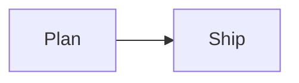

# Gallery

Every kind of block the view draws, with **strong**, *emphasis*, ~~struck~~,
`inline code` and a [link to the spec](https://example.com/spec).

## Lists

- First item
- Second item with `code`
  - A nested item
- Third item

1. One
2. Two

- [x] Parser
- [ ] Comments in the margin

## Quote and rule

> A quote, with *emphasis*.

---

## Table

| Block | Comment target |
| ----- | -------------- |
| List  | item           |
| Table | cell           |

## Code

```rust
fn main() {
    println!("hello");
}
```

```text
+-------+     +-------+
| plan  | --> | ship  |
+-------+     +-------+
```

## Diagram



## Images


The end.
