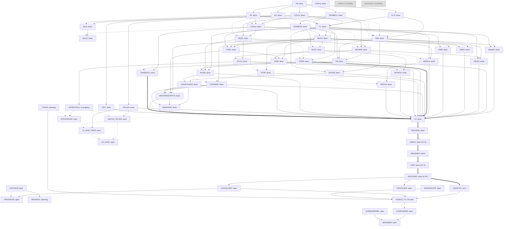

# Humata 2: milestone DAG

Written 2026-11-15 by minion D1 from the review (R1), the advice (A1) and the
docs tidy (J1). The main agent owns this file. Each node links to its
milestone file; agents read that file, not this one.

## How to read it

- **Status:** done, in progress, open (dependencies done, ready for a
  manager), code in, awaiting gate (the lane's code is applied in the tree
  and waits on a main gate before it closes), code in, closing with the
  0.2 release (the gate is passed or fixed; it closes when the fast tier
  is green and 0.2 is committed), blocked, cut (the owner
  dropped it; nothing depends on it).
- **Depends on:** a plain edge must be done before the milestone opens. An
  edge marked `*` only blocks closing: the milestone opens and builds
  without it (on fakes, or against the current frames) and cannot close
  until it is done.
- **Fakes and real:** a UI milestone is first done on fake clients, then
  for real against `humatad2`. A milestone closes only on the real tick,
  except LOOK1, LOOK2 and DESK, which are fakes-only by design.
- **Fault points:** every daemon milestone that adds a multi-step operation
  adds its PER-27 fault points in the same milestone. SAFE is the audit.

## Nodes

| ID | Goal | Layer | Lane | Depends on (reason) | Status |
|---|---|---|---|---|---|
| [D0](milestones/D0.md) | SPEC, DECISIONS and OVERVIEW tell one story | L0 | docs | — | done (d8151a80, ba1a357e) |
| [P0](milestones/P0.md) | Hot shared files are split so lanes don't collide | L0 | main | D0: the split follows the tidied docs | done (1a3831dd; `ui/src/panels.rs` and `desktop/tests/native.rs` deferred to LOOK2 while C1 holds them) |
| [W1](milestones/W1.md) | The owner answers wave 1 and the changed frames are redrawn | L0 | owner + docs | D0: the questions come from the docs tidy | done (e19c3f6d, 13121e1d) |
| [FRAMES1](milestones/FRAMES1.md) | The screens the next layers need are drawn and signed off | L0 | docs | D0: frames are drawn from the tidied rules | done (59340201) |
| [FRAMES2](milestones/FRAMES2.md) | The screens for machines, files, forks, PR reviews and views are drawn and signed off | L1 | docs | FRAMES1: same files and the same lane; the earlier frames set the patterns | done (43f7fff2) |
| [LOOK1](milestones/LOOK1.md) | The session page and sidebar look like the goldens | L0 | UI | D0: the frames and rules it matches are the tidied ones | done (ed5882ed) |
| [LOOK2](milestones/LOOK2.md) | Every other screen looks like the goldens | L1 | UI | LOOK1: shares the shell, theme and sidebar; and C1 must release the UI files; P0: the panels and native tests must be split before a second manager edits them; W1*: frames 18, 29, 31, 32, 33 change; the app matches the redrawn ones before this closes | done (this commit; look_test under 0.5% per frame; fakes bundle installed) |
| [POLISH](milestones/POLISH.md) | The app feels native and decluttered, like the goldens, one fix at a time | L1 | UI | LOOK1: polishes what LOOK1 drew | done (released in 0.2.1–0.2.5, 2026-11-17/18) |
| [STACK](milestones/STACK.md) | One command turns my commits into a linked stack of PRs, with our template and a review-history table | L1 | tools | none: standalone CLI in tools/stack | done (released in 0.2.1–0.2.5, 2026-11-17/18) |
| [ROAM](milestones/ROAM.md) | Agents propose channel repos, Desk sessions move into channels, each channel has its own Desk, and any agent conversation forks and moves | L2 | daemon+app | spec first; builds on FL, DESK, TERM | done (released in 0.2.1–0.2.5, 2026-11-17/18) |
| [FL-D](milestones/FL-D.md) | The daemon holds a real local session that survives restarts | L0 | daemon | D0: the rules it builds are the tidied ones | done (9ec5b5ed) |
| [FL](milestones/FL.md) | First light: a real session in the app that survives a reboot (0.1) | L1 | daemon + UI seam | FL-D: the app needs real Session and Channel services and holders; LOOK1: a real terminal needs the session page, tabs and sidebar; P0: the real client follows the per-service client traits P0 splits out; FRAMES1: New channel, clone progress and "Couldn't resume" have no frame yet | done (0bdf1434; humata2-v0.1.0 installed) |
| [BUG](milestones/BUG.md) | Report a bug as text an agent can act on | L1 | third builder (`report/`) | LOOK1: a recording names targets by their place in the view tree, which must be stable; P0: the app wiring adds an overlay and actions in the split files | done (ed5882ed) |
| [BUG2](milestones/BUG2.md) | Report, annotate and draw from anywhere (palette commands, draw on snapshots, live RPCs in recordings) | L2 | BUG2 | BUG: builds on the report library and app wiring; LOOK2*: shares palette/overlay ui files | done (194fd13e) |
| [TIDY](milestones/TIDY.md) | No leftovers from dropped designs in the code or API | L1 | daemon | W1: deleting an API and folders can't be undone; it waits for the owner to confirm D104 and D9 | done |
| [DESK](milestones/DESK.md) | A place to work without a channel | L2 | UI | LOOK2: the Desk page reuses the channel page, lists and empty states; FRAMES1: Clean up… has no frame yet; W1*: frame 33 may be retired and frames 37–40 print a new path; match them before this closes | done (48e1c866, 2026-11-16) |
| [ASK](milestones/ASK.md) | Agents ask, I decide | L1 | daemon, then UI | FL-D: an agent's MCP identity is its real session; FL*: flow §26.4 in the app needs a real session on screen; LOOK1*: the session Inbox panel is where the card is drawn; FRAMES1*: the channel's Inbox and Agent access tabs have no frame yet; W1*: the card in frames 03, 04, 26, 27 is redrawn; match it before this closes | done (0bdf1434; gaps in GAPS_REVIEW freeze 2) |
| [MACH](milestones/MACH.md) | Work on another machine | L2 | daemon | FL: a remote session is a local session plus a link; FRAMES2: Add machine, the login dialog and the machine page have no frame yet | done (0bdf1434; not_built calls carried to SAFE/FILES follow-ups) |
| [REVIEW](milestones/REVIEW.md) | Review what the agent changed, in code and in documents (0.2) | L3 | UI, then daemon seam | DESK: markdown comments and diff comments are one model; the document tab opens from the Desk too; FRAMES1: comment states and the comment box in a diff have no frame yet; FL*: sending comments needs a real terminal and turn ends; diffs need real clones | done (48e1c866, 2026-11-16) |
| [BOARD](milestones/BOARD.md) | Plan the work on boards | L2 | UI + daemon | ASK: agent board edits are access-checked and become requests answered on the item; LOOK2: the board, table, dashboard and item drawer are drawn there | done (this commit; owner's wave: how a session's own items are marked in its Board panel) |
| [FORK](milestones/FORK.md) | Fork, move, archive and rebuild a session | L3 | daemon + UI | MACH: forks and moves across machines need the link; ASK: an agent's fork is an Inbox request; FRAMES2: Fork, Move, Archive with unpushed work and an archived session have no frame yet | done (50711fd6; owed follow-ups in its Lane) |
| [FILES](milestones/FILES.md) | Move files and keep disks tidy | L3 | daemon + UI | MACH: transfers ride the machine link; Storage is per machine; FRAMES2: the file manager, transfers tray and Storage have no frame yet | done (0bdf1434; Storage per machine owed) |
| [AWAY](milestones/AWAY.md) | Keep working with the host closed | L3 | daemon | MACH: away mode is machines without the host; ASK: a machine judges requests against a copy of the rules | done (48e1c866, 2026-11-16) |
| [FIND](milestones/FIND.md) | Find and reach anything | L3 | UI + daemon | MACH: search runs over the conversation mirror from every machine; LOOK2: the palette and the Pinned section are drawn there | done (this commit; owed §26.22 steps 1, 3, 4) |
| [VIEWS](milestones/VIEWS.md) | Agents prepare views; I choose to open them | L4 | UI + daemon | ASK: preparing a view is rule-gated; REVIEW: a prepared review opens in the diff and editor; FRAMES2: the prepared view's tab and Showing bar have no frame yet | done (released in 0.2.1–0.2.5, 2026-11-17/18) |
| [PR](milestones/PR.md) | Review a pull request with an agent beside me | L4 | UI + daemon | REVIEW: a PR review is the review surface plus drafts; ASK: the review chat's tools are scoped by access; FRAMES2: the PR dialog, review session and Submit review have no frame yet | done (released in 0.2.1–0.2.5, 2026-11-17/18) |
| [SAFE](milestones/SAFE.md) | Nothing is lost, ever | L4 | daemon | MACH: add machine and install must exist to be cut; FORK: moves and forks must exist to be cut; FILES: transfers must exist to be cut | done (released in 0.2.1–0.2.5, 2026-11-17/18) |
| [STOP](milestones/STOP.md) | Stop everything on a machine, and bring it back later | L4 | daemon + UI | MACH: a machine page and link must exist; SAFE*: reuses its shutdown, bring-back, restart report and doctor | done (released in 0.2.1–0.2.5, 2026-11-17/18) |
| [LINUX](milestones/LINUX.md) | The same app on Linux | L5 | exclusive (nothing else builds) | SAFE: the owner's rule: the Linux batch runs only after all infrastructure work; ASK: its boundary suites are part of the batch; BUG: its suites are part of the batch | **cut** (owner, 2026-11-16: scope is the macOS desktop only, D485) |
| [ANYHOST](milestones/ANYHOST.md) | Any client, any host | L6 | daemon | LINUX: a self-hosted host is a Linux host; its suites run in the VM | **cut** (owner, 2026-11-16, with the browser client: macOS desktop only, D485) |
| [HOOKS](milestones/HOOKS.md) | Agents tell Humata when a turn ends and ask for approval in the Inbox, without terminal guesswork | L3 | daemon | ASK: asks land as Inbox requests; FL: turn ends already detected | done (0bdf1434; live hook checks owed) |
| [NEWCH](milestones/NEWCH.md) | New channel lets me pick repos from gh and machines, as drawn | L4 | UI + clients | MACH: machines and online state; FL: channel creation and clone progress; REVIEW*: shares ui/ and look_test | done (48e1c866, 2026-11-16) |
| [TERM](milestones/TERM.md) | Session tabs run on the reusable terminal in the desktop app (the browser half is cut, D485) | L4 | ui + clients | FL: app on the real daemon; DESK*/REVIEW*: share ui/ and look_test | done (released in 0.2.1–0.2.5, 2026-11-17/18); its remaining batch (`retag_live.py`, the vim Escape check; see its Lane) is not yet recorded as run |
| [UPGRADE](milestones/UPGRADE.md) | Any Humata found at another version is upgraded at once | L4 | daemon + clients + UI | MACH: link + Hello version; STOP*/SAFE*: re-exec and cut safety | done (released in 0.2.1–0.2.5, 2026-11-17/18) |
| [DOCV](milestones/DOCV.md) | A proposal doc keeps versions I can step back and forward through, in a folder Humata makes for me | L4 | daemon + UI | DESK: Desk folders and the New desk session dialog; REVIEW: the document tab, comments and diff view | done (released in 0.2.1–0.2.5, 2026-11-17/18) |
| [NOPATH](milestones/NOPATH.md) | I pick repos and machines, never folders: Humata places everything under roots I set once | L4 | docs, then daemon + UI | FILES: transfers and the file manager; DOCV*: shares the Desk folder rules | done (released in 0.2.1–0.2.5, 2026-11-17/18) |
| [REPOS](milestones/REPOS.md) | A repo I add once is known everywhere, and I find repos by fuzzy search scoped to my usual orgs unless I widen it | L4 | daemon + clients + UI | NEWCH: the repo picker and D274 search; NOPATH*: drops the local-path source | done (released in 0.2.1–0.2.5, 2026-11-17/18) |
| [V1](milestones/V1.md) | Replace Humata 1 (1.0) | L7 | main | BOARD, PR, VIEWS, AWAY, FIND, NEWCH, TERM, HOOKS, UPGRADE, SAFE, DOCV, NOPATH, REPOS, ROAM, POLISH, AGENTKINDS, AGENTSET, MACHINESCRIPTS, OWNERFIX: every §26 flow passes; STOP: a last-resort stop exists; TIDY: no dropped designs ship. (LINUX and ANYHOST are cut, D485.) | done (released as 0.2.x, 2026-11-17/18) |
| [AGENTKINDS](milestones/AGENTKINDS.md) | Codex and Copilot start, resume and fork like Claude | L3 | daemon + CLI | HOOKS: agent hooks report turns; ROAM: conversation adapters (Copilot) | done (released in 0.2.1–0.2.5, 2026-11-17/18) (built-in Codex and Copilot; resume, fork and attach fixes; D670–675) |
| [MACHINESCRIPTS](milestones/MACHINESCRIPTS.md) | I script what happens when a machine is added, reconnects, or a session arrives on or leaves it | L4 | daemon + CLI + clients + UI | MACH: add, reconnect and the peer link; FORK: the move (`MoveSession`); AGENTKINDS: a step can start Codex or Copilot; UPGRADE: the `~/.humata2/config` push to machines | done (released in 0.2.1–0.2.5, 2026-11-17/18) (rules on added, connected, upgraded, session-arrived and session-leaving; D680–689) |
| [AGENTSET](milestones/AGENTSET.md) | I choose which agents Humata offers, and Humata installs only its own tools unless I say otherwise | L4 | daemon + clients + features + UI | AGENTKINDS: the built-in kinds it switches; MACHINESCRIPTS: `agents.toml` ships beside `repos.toml`, and its `start` step uses the same gate; UPGRADE: Humata's own tools are always installed and upgraded | done (released in 0.2.1–0.2.5, 2026-11-17/18) (Settings › Agents switches; third-party CLIs installed only with the per-agent "Install when missing"; D720–729) |
| OWNERFIX (no milestone file; WORKLOG) | The frames Fable asked to fix look right, and PR drafts are kept when a review is archived | L4 | UI + daemon | LOOK2: the frames it fixes; PR: drafts on archive (D513 ruling) | done (in 0.2.2) |
| [RELEASE](milestones/RELEASE.md) | The macOS desktop app is published and installed | L8 | main | V1: release what replaces Humata 1 | done (humata2-v0.2.1 through v0.2.5 published and installed, 2026-11-17/18) |
| [VERIFY](milestones/VERIFY.md) | Every user flow is reproduced, reviewed for usability, and its fixes are covered by tests | L9 | cases, reproduction, review, TDD fixes | RELEASE: the final jank review runs on what was released | done in 0.3.0: Copilot passes and the owner-screen drive (2026-11-18) found the bugs fixed in 0.2.2–0.2.5 and the 0.3 batch (End for good, /clear and /restart following, terminal focus after Resume, Inbox terminal clicks, empty-channel sessions, real-VM SSH flows); Codex and Claude Code move to AGENTS2 |
| [RELEASE2](milestones/RELEASE2.md) | The jank-review fixes are published and installed | L10 | main | VERIFY: publish the jank-review fixes | done (0.2.2–0.2.4 carry the VERIFY fixes) |
| [FAST](milestones/FAST.md) | An optional fast mode makes Humata measurably lighter and quicker | L11 | perf | RELEASE2: profile from the published post-review build; VERIFY: profile and tune only once behaviour is settled and covered by tests | done (in 0.2.5: no idle blink in fast mode or in background windows, holder scrollback 42→18 MiB, new idle-cost benches; D787–D789) |
| [RELEASE3](milestones/RELEASE3.md) | Fast mode is published and installed | L12 | main | FAST: publish fast mode | done (humata2-v0.3.0, 953bb942, released and installed 2026-11-18 08:56; focused tests only, by the owner's 9:30 deadline; full fast tier on/off and slow tier still owed) |
| [AGENTS2](milestones/AGENTS2.md) | Claude Code and Codex are first-class agents, read through their own structured channels | L13 | daemon + agent_hooks + clients + UI | RELEASE3: starts after 0.3 (owner, 2026-11-18) | next |
| [STACKVIEW](milestones/STACKVIEW.md) | An agent sends a change as a stack of layers, and I step through it across repos | L13 | api + daemon + clients + UI | RELEASE3: builds on the released review view; parallel to AGENTS2, no shared files | planning (owner, 2026-11-18; D791, RV-36) |
| [LIVEHOLDER](milestones/LIVEHOLDER.md) | My terminals keep running: a version bump, a rename or a move never ends them | L13 | daemon/holder + upgrade + revive | RELEASE3: builds on Migrate the holders (D373); parallel to AGENTS2 and STACKVIEW | planning (owner, 2026-11-18) |
| [PROVIDERS](milestones/PROVIDERS.md) | I add machines from custom providers in the app, and agents can find and import providers without admin mode | L13 | daemon + CLI + clients + UI | none (owner live repro, 2026-11-18 12:05) | done: live CLI rerun 15:15, 0.3.4 |
| [DIFFVIEW](milestones/DIFFVIEW.md) | I open any changed file across a session's repos and read its whole diff, big ones too, smoothly; the prepared PR view works | L13 | UI + clients + daemon | none (owner, 2026-11-18 12:25) | done (DV-1–DV-19 + PR >1,500-line virtual box D877; shipping in 0.3.10) |
| [PROGRESS](milestones/PROGRESS.md) | Anything that takes more than a moment shows the step it is on and a thin bar where I started it: filled when the daemon can measure, sweeping when it can't, with elapsed time after 10 s | L13 | daemon + clients + UI | none for T0–T5; LIVEHOLDER T6 for T6; DIFFVIEW* (panel_changes.rs) for T7 | done (T0–T10 ticked, frames 122–126 recorded; shipping in 0.3.10) |
| [REVIEWUI](milestones/REVIEWUI.md) | Reviewing a pull request feels like reading the Diff panel: Submit review sits by the drafts, full screen and back keep my exact place, every control names itself on hover, and the diff can be driven from the keyboard | L13 | UI + clients + features | DIFFVIEW (DV-5 for RV-2 and RV-8; DV-16 and DV-18 for RV-1); parallel to STACKVIEW, sharing only the layer-key pick (RV-5 → T8) | planning (owner, 2026-11-18; spec DIFFVIEW-spec.md, cases flows/cases/diff/) |
| [MASSDELETE](milestones/MASSDELETE.md) | I can delete many sessions at once, through one stale-safe plan and confirmation | L13 | daemon + CLI + UI | none: builds on the existing one-session delete gate; it defines the topology-delete boundary FUSEFS must preserve | open (owner, 2026-11-19) |
| [TODO2](milestones/TODO2.md) | Smarter To-do ranking, fast triage, structured agent collaboration, and two-way PR/session lifecycle sync | L13 | daemon + clients + features/todo + UI | BOARDSIMPLE, INBOXHOOKS, REVIEWUI/STACKVIEW/DIFFVIEW, AGENTS2; scheduled before FUSEFS | planning (owner, 2026-11-19) |
| [FUSEFS](milestones/FUSEFS.md) | One lazy, stable filesystem-shaped view of Humata state across every machine (built over standalone `//libs/fusefs/*` crates), plus native per-session config homes with toggleable/scriptable non-auth sync and zero host-sync blocking | L14 | `libs/fusefs/*` + daemon adapter + config compose + platform packaging | MASSDELETE: unlink/rename cannot bypass planned deletes; LIVEHOLDER: native paths, sync toggles and holders survive rename and upgrade; AGENTS2: all agent config/state adapters are known; TODO2: scheduled immediately before FUSEFS; MACH/AWAY/NOPATH/UPGRADE/MACHINESCRIPTS: machine identity, `PeerUplink`, roots, script safety and Migrate already exist | planning (owner, 2026-11-19; spec and one-day spike first) |
| [FUSEFSWIRE](milestones/FUSEFSWIRE.md) | FUSEFS is actually on: humatad2 runs the mount as a fifth helper, sessions get native config homes with a zero-restart sync switch, moves carry chunks through the shared chunk store, and Settings › Sync controls it; it survives restarts, power cuts and link drops, proven on Lima remotes (T13) | L15 | proto + daemon + sessions_carry + MCP + clients + Settings UI | FUSEFS T1–T10 (12305aba); Settings › Sync frame from Fable first | open (owner, 2026-11-20; ships 0.6.0) |
| [SCREENPARSE](milestones/SCREENPARSE.md) | Agent prompts on screen are read right for every agent, tested against recordings of the real CLIs driven by cheap models | L15 | svc_inbox + agent_hooks + slow-tier live recorder | HOOKCLEAR (fixes its regressions first) | open (owner, 2026-11-20; ships 0.6.1) |
| [BROWSER](milestones/BROWSER.md) | Claude Code, Codex, Copilot and agy read my real browser tabs and, with my per-action approval, click, type and navigate; read can be granted for 30 min, write never | L16 | proto + humatad2 browser-host + svc_mcp + svc_inbox + clients + UI | core crates (12305aba); FUSEFSWIRE and SCREENPARSE release first; frames from Fable first | open (owner, 2026-11-20; ships 0.7.0) |
| [INTENTSPEC](milestones/INTENTSPEC.md) | In any Desk or Channel Desk session, an agent drafts a schema-validated `intent.yaml` (`humata.intent/v1`) rendered in a `Structured \| YAML \| Diff` pane with `DOCV` versioning, inline comments, and `Approve & Start Milestone` | L16 | `intent_spec` + `features/session` + `ui/changes` + skill | DOCV, MILESTONES | in progress (owner, 2026-11-21) |
| [INTENTMODE](milestones/INTENTMODE.md) | Board "Intent Mode": living LLM-authored Intent Packages (`DRAFT`, `TODO`, `IN PROGRESS`, `IN REVIEW`, `BLOCKED`, `DONE` + due dates) replace heavy To-do management, spawn multiple tagged sessions that continuously write back what is done and what remains, and notify me when an intent needs review or a decision | L17 | `intent_spec` + `svc_board` + `svc_mcp` + `features/todo` + `ui/changes` + `ui/workspace` | INTENTSPEC, BOARDSIMPLE, NOTIFYAUDIT, REVIEW_UI_AND_WEB | open (owner, 2026-11-21; mockups approved `im-1..im-6`) |
| [MACOS_POLISH](milestones/MACOS_POLISH.md) | Native macOS visual & interaction polish in 3 surgical waves: Theme sync + cursors + light-mode hairlines + overlay scrollbars (W1), window vibrancy + 52pt titlebar alignment + inactive dimming + rail/tabs/type (W2), hit targets + menus + diff/todo/modal/settings polish (W3) | L17 | `ui/core` + `desktop/src` + `ui/*` | LOOK2, POLISH; INTENTSPEC* (shares `ui/changes`, `ui/workspace`, native snapshots) | open (owner, 2026-11-21) |
| [UI_JANK_FIXES](milestones/UI_JANK_FIXES.md) | Fix 26 verified UI/UX jank, crash, keystroke-loss, painted-over menu, focus-trap, text-cutoff, dead-end, and large-list virtualization bugs across `ui/` and `features/` in 3 waves (W-A P0 crashes/focus/menus, W-B cutoffs/tooltips/depth, W-C dead-ends/races/virtualization) | L17 | `ui/*` + `features/{app,session,files}` | LOOK2, POLISH; MACOS_POLISH* (shares `ui/*` files & native snapshots) | open (owner, 2026-11-21) |
| [UX_FILES](UX_FILES.md) | macOS native UX deviations, embedded terminal fixes (OSC 52 real clipboard, Light ANSI palette, OSC 10/11 + `COLORFGBG` + DEC 2031, `TerminalTheme`, saved font family, `Ctrl+C`/Option-as-Alt/cmd-line nav, paste prompt), menu bar + shortcuts + context menus + macOS Dock reopen/window bounds, real Dock badge + DND sound + Finder drop + copy feedback + microcopy, and dead Markdown links + `.cleanable()`/`.mask_toggle()`/`⌘Enter` + code copy | L17 | `terminal/*` + `daemon/{vt_authority,holder}` + `markdown` + `desktop/src` + `features/*` + `ui/*` | MACOS_POLISH*, UI_JANK_FIXES* (deduplicated; shares `ui/*` & `desktop/src`) | open (owner, 2026-11-21) |

## Critical path

Fast tier (fast mode off and on) → slow tier once → commit and push → release 0.3 (RELEASE3) → 0.3.1 (released 10:37) → AGENTS2, STACKVIEW and LIVEHOLDER in parallel.

FUSEFS is a later L14 fan-in. It cannot open until AGENTS2, LIVEHOLDER and
MASSDELETE define the stable agent, holder and destructive boundaries it must
preserve. Its first deliverable is only the one-day spike; the measured result
gates how much of config, databases and working directories enters the mount.

- Gate 30 has reported (605 of 678 passed) and its failures went to fix agents lane by lane
  (2026-11-17). Every "code in" lane, OWNERFIX included, and V1 close
  together with the 0.2 release once the fast tier is green and the slow
  tier has passed once. Their commit is still pending.
- VERIFY started early (owner, 2026-11-17 14:05), before RELEASE, so it
  runs beside the close-out rather than after it. Its reruns use the 0.2
  build.
- After VERIFY the chain is in the owner's order and runs one at a time:
  RELEASE2, then FAST, then RELEASE3.
- LINUX and ANYHOST are cut (owner, 2026-11-16, D485). They are no longer
  on the path. Scope is the macOS desktop only.

## What can open now

Lane limit (CONFIG.md): 10 managers. Opinions go to Fable 5.2, not the owner.

1. **The close-out.** Main runs the fast tier until it is green, then the
   slow tier once (power-cut suites, live flows, rebuild, archive and PR
   review). Then it commits and pushes, releases 0.2 and installs it.
2. **VERIFY** stays in progress: rebuild its binaries from the 0.2 build,
   rerun the Copilot flows, fix what they find test-first.
3. **TERM's remaining batch** (`retag_live.py` once `shell_screen::` passes,
   and the vim Escape check, `vim_escape.py` if it fails) is not recorded
   as run; check its Lane before the commit.
4. **RELEASE2**, **FAST** and **RELEASE3** open in that order, each when the
   one before it closes.

## Test tiers (2026-11-17)

- **Fast tier:** the default run. Every gate and every lane uses it.
- **Focused tests:** each fix runs only the targets that cover it.
- **Slow tier:** the power-cut suites, live flows, rebuild, archive and PR
  review. It runs once before each release, not on every gate.

## Release points

- humata2-v0.1.0 is released and installed (closed FL).
- humata2 0.2 is next: it carries every "code in" lane, OWNERFIX and V1,
  and is installed in /Applications. VERIFY reruns against it.
- Release often: after every milestone or two, on a clean tree, installed
  in /Applications.

## Not in 1.0 (to confirm in W1)

Owner, 2026-11-15: only the VM tier (PER-8–PER-10) stays out of 1.0. Contain agents (SEC-6), script tokens (SEC-14)
and Delete channel (CH-24, D11 (a), frame 71) are in 1.0; their milestone homes are logged in the event log.

Owner, 2026-11-16 (D485): LINUX, ANYHOST, the browser client and TERM's
browser half are cut. 1.0 is the macOS desktop app.

## Graph

Thick arrows are the critical path. Dotted arrows block closing only. Cut
nodes are grey and have no edges.

