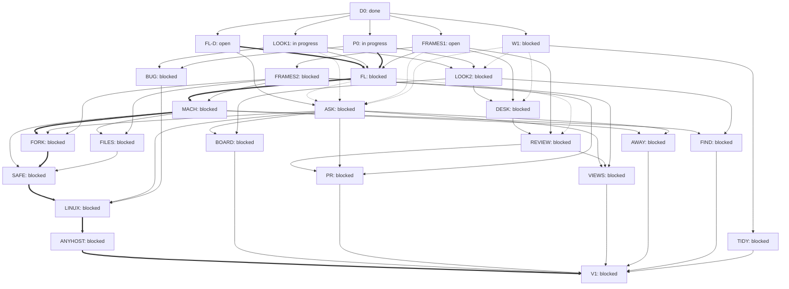

# Humata 2: milestone DAG

Written 2026-11-15 by minion D1 from the review (R1), the advice (A1) and the
docs tidy (J1). The main agent owns this file. Each node links to its
milestone file; agents read that file, not this one.

## How to read it

- **Status:** done, in progress, open (dependencies done, ready for a
  manager), blocked.
- **Depends on:** a plain edge must be done before the milestone opens. An
  edge marked `*` only blocks closing: the milestone opens and builds
  without it (on fakes, or against the current frames) and cannot close
  until it is done.
- **Fakes and real:** a UI milestone is first done on fake clients, then
  for real against `humatad2`. A milestone closes only on the real tick,
  except LOOK1, LOOK2 and DESK, which are fakes-only by design.
- **Fault points:** every daemon milestone that adds a multi-step operation
  adds its PER-27 fault points in the same milestone. SAFE is the audit.

## Nodes

| ID | Goal | Layer | Lane | Depends on (reason) | Status |
|---|---|---|---|---|---|
| [D0](milestones/D0.md) | SPEC, DECISIONS and OVERVIEW tell one story | L0 | docs | — | done (d8151a80, ba1a357e) |
| [P0](milestones/P0.md) | Hot shared files are split so lanes don't collide | L0 | main | D0: the split follows the tidied docs | done (1a3831dd; `ui/src/panels.rs` and `desktop/tests/native.rs` deferred to LOOK2 while C1 holds them) |
| [W1](milestones/W1.md) | The owner answers wave 1 and the changed frames are redrawn | L0 | owner + docs | D0: the questions come from the docs tidy | blocked (waiting on the owner; the main agent asks now) |
| [FRAMES1](milestones/FRAMES1.md) | The screens the next layers need are drawn and signed off | L0 | docs | D0: frames are drawn from the tidied rules | in progress (lane FRAMES1) |
| [FRAMES2](milestones/FRAMES2.md) | The screens for machines, files, forks, PR reviews and views are drawn and signed off | L1 | docs | FRAMES1: same files and the same lane; the earlier frames set the patterns | blocked |
| [LOOK1](milestones/LOOK1.md) | The session page and sidebar look like the goldens | L0 | UI | D0: the frames and rules it matches are the tidied ones | in progress (minion C1, outside this workflow; do not hand out) |
| [LOOK2](milestones/LOOK2.md) | Every other screen looks like the goldens | L1 | UI | LOOK1: shares the shell, theme and sidebar; and C1 must release the UI files; P0: the panels and native tests must be split before a second manager edits them; W1*: frames 18, 29, 31, 32, 33 change; the app matches the redrawn ones before this closes | blocked |
| [FL-D](milestones/FL-D.md) | The daemon holds a real local session that survives restarts | L0 | daemon | D0: the rules it builds are the tidied ones | done (9ec5b5ed) |
| [FL](milestones/FL.md) | First light: a real session in the app that survives a reboot (0.1) | L1 | daemon + UI seam | FL-D: the app needs real Session and Channel services and holders; LOOK1: a real terminal needs the session page, tabs and sidebar; P0: the real client follows the per-service client traits P0 splits out; FRAMES1: New channel, clone progress and "Couldn't resume" have no frame yet | blocked |
| [BUG](milestones/BUG.md) | Report a bug as text an agent can act on | L1 | third builder (`report/`) | LOOK1: a recording names targets by their place in the view tree, which must be stable; P0: the app wiring adds an overlay and actions in the split files | blocked |
| [TIDY](milestones/TIDY.md) | No leftovers from dropped designs in the code or API | L1 | daemon | W1: deleting an API and folders can't be undone; it waits for the owner to confirm D104 and D9 | blocked |
| [DESK](milestones/DESK.md) | A place to work without a channel | L2 | UI | LOOK2: the Desk page reuses the channel page, lists and empty states; FRAMES1: Clean up… has no frame yet; W1*: frame 33 may be retired and frames 37–40 print a new path; match them before this closes | blocked |
| [ASK](milestones/ASK.md) | Agents ask, I decide | L1 | daemon, then UI | FL-D: an agent's MCP identity is its real session; FL*: flow §26.4 in the app needs a real session on screen; LOOK1*: the session Inbox panel is where the card is drawn; FRAMES1*: the channel's Inbox and Agent access tabs have no frame yet; W1*: the card in frames 03, 04, 26, 27 is redrawn; match it before this closes | blocked |
| [MACH](milestones/MACH.md) | Work on another machine | L2 | daemon | FL: a remote session is a local session plus a link; FRAMES2: Add machine, the login dialog and the machine page have no frame yet | blocked |
| [REVIEW](milestones/REVIEW.md) | Review what the agent changed, in code and in documents (0.2) | L3 | UI, then daemon seam | DESK: markdown comments and diff comments are one model; the document tab opens from the Desk too; FRAMES1: comment states and the comment box in a diff have no frame yet; FL*: sending comments needs a real terminal and turn ends; diffs need real clones | blocked |
| [BOARD](milestones/BOARD.md) | Plan the work on boards | L2 | UI + daemon | ASK: agent board edits are access-checked and become requests answered on the item; LOOK2: the board, table, dashboard and item drawer are drawn there | blocked |
| [FORK](milestones/FORK.md) | Fork, move, archive and rebuild a session | L3 | daemon + UI | MACH: forks and moves across machines need the link; ASK: an agent's fork is an Inbox request; FRAMES2: Fork, Move, Archive with unpushed work and an archived session have no frame yet | blocked |
| [FILES](milestones/FILES.md) | Move files and keep disks tidy | L3 | daemon + UI | MACH: transfers ride the machine link; Storage is per machine; FRAMES2: the file manager, transfers tray and Storage have no frame yet | blocked |
| [AWAY](milestones/AWAY.md) | Keep working with the host closed | L3 | daemon | MACH: away mode is machines without the host; ASK: a machine judges requests against a copy of the rules | blocked |
| [FIND](milestones/FIND.md) | Find and reach anything | L3 | UI + daemon | MACH: search runs over the conversation mirror from every machine; LOOK2: the palette and the Pinned section are drawn there | blocked |
| [VIEWS](milestones/VIEWS.md) | Agents prepare views; I choose to open them | L4 | UI + daemon | ASK: preparing a view is rule-gated; REVIEW: a prepared review opens in the diff and editor; FRAMES2: the prepared view's tab and Showing bar have no frame yet | blocked |
| [PR](milestones/PR.md) | Review a pull request with an agent beside me | L4 | UI + daemon | REVIEW: a PR review is the review surface plus drafts; ASK: the review chat's tools are scoped by access; FRAMES2: the PR dialog, review session and Submit review have no frame yet | blocked |
| [SAFE](milestones/SAFE.md) | Nothing is lost, ever | L4 | daemon | MACH: add machine and install must exist to be cut; FORK: moves and forks must exist to be cut; FILES: transfers must exist to be cut | blocked |
| [LINUX](milestones/LINUX.md) | The same app on Linux | L5 | exclusive (nothing else builds) | SAFE: the owner's rule: the Linux batch runs only after all infrastructure work; ASK: its boundary suites are part of the batch; BUG: its suites are part of the batch | blocked |
| [ANYHOST](milestones/ANYHOST.md) | Any client, any host | L6 | daemon | LINUX: a self-hosted host is a Linux host; its suites run in the VM | blocked |
| [V1](milestones/V1.md) | Replace Humata 1 (1.0) | L7 | main | ANYHOST: 1.0 runs on both platforms and in a browser; BOARD: every §26 flow passes; PR: every §26 flow passes; VIEWS: every §26 flow passes; AWAY: every §26 flow passes; FIND: every §26 flow passes; TIDY: no dropped designs ship | blocked |

## Critical path

FL-D → FL → MACH → FORK → SAFE → LINUX → ANYHOST → V1.

- LOOK1 (C1's restyle), P0 and FRAMES1 feed FL; any of them late delays it.
- FILES also feeds SAFE and is near-critical. FRAMES2 gates MACH, FORK and
  FILES, so the docs lane must not fall behind the daemon lane.
- W1 blocks nothing from opening, but LOOK2, DESK and ASK cannot close
  without it, and TIDY cannot start.

## What can open now

Lane limit (CONFIG.md): 3 managers, 2 that build (1 UI, 1 daemon) and 1 docs.

1. **FL-D** (daemon lane). Head of the critical path; touches nothing C1 or
   P0 holds. Open first.
2. **FRAMES1** (docs lane). Draw New channel, clone progress and
   "Couldn't resume" first. Its frames are code (`desktop/tests/design/`),
   so they are recorded at the normal gates.
3. **UI lane: no manager yet.** LOOK1 is minion C1's work in progress and
   P0 is splitting the shared UI files. Open LOOK2 when C1's claim is
   released, LOOK1 is marked done and P0 has landed.
4. **W1** is the owner's. The main agent asks it now, in one wave.

Next, as dependencies close: ASK after FL-D (daemon lane, while FL
integrates); BUG as the third builder once LOOK1 and P0 are done (it lives
in `report/`); FRAMES2 after FRAMES1; TIDY after W1.

## Release points

A release (clean tree, full gate, installed in /Applications) after LOOK2
and DESK (on fakes, labelled so), then after every real close from FL on.

## Not in 1.0 (to confirm in W1)

The VM tier (PER-8–PER-10), Contain agents (SEC-6), script tokens (SEC-14), Delete channel (CH-24). No milestone
owns them.

## Graph

Thick arrows are the critical path. Dotted arrows block closing only.

